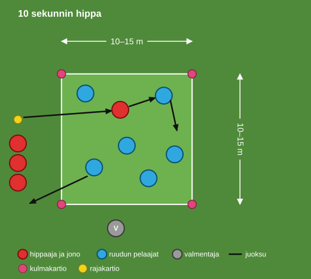

# 10 sekunnin hippa

## Tavoite
Pelaaja kehittää lähtönopeutta, kiihdytystä ja suunnanmuutoksia. Hippaaja
tekee 10 sekunnin maksimaalisen suorituksen, ja ruudun pelaajat väistelevät
nopeilla jarrutuksilla ja suunnanmuutoksilla.

## Järjestelyt
- Ruutu 10–15 × 10–15 m pelaajamäärän mukaan.
- Lähtökartio 3–5 metrin päähän ruudun yhdeltä reunalta.
- Ryhmä jaetaan kahteen osaan: puolet pelaajista ruudun sisällä, puolet
  jonossa lähtökartion takana. Esimerkiksi 12 pelaajaa, 6 + 6. Isommalle
  ryhmälle tehdään toinen ruutu viereen.
- Välineet: 5 kartiota, sekuntikello.

## Kulku
1. Jonon ensimmäinen lähtee omasta aloitteestaan ja sprinttaa ruutuun.
   Valmentaja käynnistää kellon lähdöstä.
2. Hippaajalla on 10 sekuntia aikaa hipata mahdollisimman monta ruudun
   pelaajaa. Hipattu pelaaja poistuu heti ruudusta ja menee jonon perälle.
3. Ruudun pelaajat väistelevät ruudun sisällä. Ruudusta ulos astunut
   pelaaja katsotaan hipatuksi.
4. Kun 10 sekuntia on kulunut, valmentaja viheltää. Hippaaja jää ruutuun
   väistelijäksi, ja jonon seuraava lähtee hippaamaan.
5. Kierros päättyy, kun ruudussa ei ole enää ketään hipattavaa. Uusi kierros
   aloitetaan jakamalla ryhmä uudelleen kahteen osaan.
6. Kierrosten välissä palautus, jotta jokainen 10 sekunnin suoritus tehdään
   täydellä teholla.

## Valmennuspisteet
Valitaan 1–2 kerrallaan.
- Lähde räjähtävästi: matala asento ja lyhyet, nopeat ensiaskeleet.
- Hippaajana valitse lähin kohde heti ruutuun tullessa ja vaihda kohdetta
  nopeasti hipattuasi.
- Jarruta matalalla painopisteellä ja lähde uuteen suuntaan ulkojalalla
  työntäen.
- Väistelijänä pidä katse hippaajassa ja reagoi hänen suuntaansa.
- Käytä koko ruutua, mutta älä jää kulmaan jumiin.

## Onnistumisen mittari
Hippaajat liikkuvat koko 10 sekunnin ajan täydellä teholla, väistelijät
välttävät hipat suunnanmuutoksilla eivätkä pelkästään juoksemalla
karkuun, ja ruutu tyhjenee kierros kierrokselta nopeammin.
