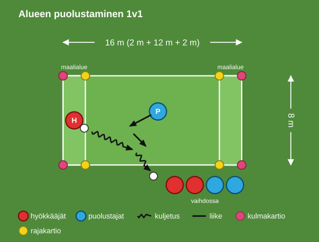

# Alueen puolustaminen 1v1

## Tavoite
Puolustaja oppii painostamaan pallollista, ohjaamaan hänet lähemmän sivurajan
yli ja ajoittamaan riiston hetkeen, jolloin hyökkääjä tekee virheen, esimerkiksi
liian pitkän kosketuksen. Harjoite on vastinpari harjoitteelle
Hyökkääminen alueelle 1v1 (`hyokkaaminen-alueelle-1v1`).

## Järjestelyt
- Suorakaiteen muotoinen alue 16 × 8 m: pelialue 12 m ja sen kummassakin
  päädyssä 2 m syvä maalialue koko alueen leveydeltä.
- Sivuraja, jolle ohjataan, määräytyy sen mukaan, kummalla puolella aluetta
  pallo on: puolustaja ohjaa pallollisen lähemmän sivurajan yli.
- Kaksi pelaajaa pelaa 1v1 ja muut odottavat vaihdossa alueen sivulla.
- 4–6 pelaajaa per suorituspaikka, joista 2 pelaa ja 2–4 on vaihdossa.
  Useita suorituspaikkoja mahtuu rinnakkain 8v8-kentälle (60 × 40 m).
- Harjoitteen voi sijoittaa vasemmalle laitakaistalle (VLK), keskikaistalle (KK)
  tai oikealle laitakaistalle (OLK).
- Välineet: 8 kartiota (4 kulmiin, 4 maalialueiden rajoille), liivit, palloja.

## Kulku
1. Hyökkääjä aloittaa pallon kanssa toisen päädyn maalialueelta ja hyökkää
   kohti vastakkaista päätyä. Puolustaja aloittaa pelialueen keskeltä.
2. Hyökkääjä saa maalin pysäyttämällä pallon jalan alle maalialueella.
3. Puolustaja saa pisteen, kun hän ohjaa hyökkääjän tai pallon lähemmän
   sivurajan yli tai riistää pallon hallintaansa.
4. Jokaisen tilanteen jälkeen hyökkäyssuunta vaihtuu kohti toista päätyä.
   Uusi tilanne alkaa heti, kun puolustaja on siirtynyt takaisin pelialueen
   sisään.
5. Roolit pysyvät samoina koko intervallin ajan. Pelaajat vaihdetaan
   intervallina, esim. 30 sekuntia peliä ja 30 sekuntia lepoa, ja roolit
   vaihtuvat seuraavaan intervalliin.

## Valmennuspisteet
Valitaan 1–2 kerrallaan.
- **1P:** nopea lähtö pallollista kohti, kun hyökkääjä katsoo palloa.
- **1P:** jarrutus ja matala sivuasento ennen kaksinkamppailua.
- **1P:** tule hyökkääjän eteen sisäpuolelta, niin että ainoa vapaa suunta on lähempi sivuraja.
- **1P:** pidä etäisyys, joka ei päästä hyökkääjää ohi mutta ei myöskään anna hänen kiertää.
- **1P:** riisto vasta, kun hyökkääjä tekee virheen (liian pitkä kosketus, katse pallossa, huono asento).
- **1P:** jos et voi riistää, jatka ohjaamista äläkä syöksy.

## Onnistumisen mittari
Puolustajat pakottavat yhä useamman hyökkääjän sivurajan suuntaan ja
riistävät pallon useammin oikealla hetkellä kuin syöksymällä. Puolustajan
pisteitä lasketaan intervallin aikana.
