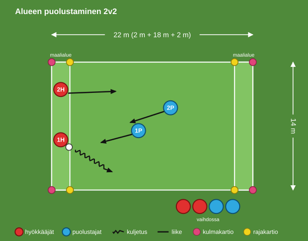

# Alueen puolustaminen 2v2

## Tavoite
Puolustajat oppivat jakamaan tehtävät pelin keskuksessa: 1P painostaa
pallollista ja ohjaa hänet lähemmän sivurajan suuntaan, ja 2P sulkee
syöttölinjan toiselle hyökkääjälle ja varmistaa 1P:n takana. Riisto ajoitetaan
hyökkääjän virheeseen. Harjoite on jatkoa harjoitteelle Alueen puolustaminen 1v1
(`alueen-puolustaminen-1v1`).

## Järjestelyt
- Suorakaiteen muotoinen alue 22 × 14 m: pelialue 18 m ja sen kummassakin
  päädyssä 2 m syvä maalialue koko alueen leveydeltä. Pituus ja leveys ovat
  kasvaneet 1v1-versiosta, jotta hyökkääjillä on tilaa syöttöpeliin ja
  puolustajien välille syntyy etäisyys, jota 2P:n täytyy hallita.
- Sivuraja, jolle ohjataan, määräytyy sen mukaan, kummalla puolella aluetta
  pallo on: puolustajat ohjaavat pallollisen lähemmän sivurajan yli.
- Neljä pelaajaa pelaa 2v2 ja muut odottavat vaihdossa alueen sivulla.
- 6–8 pelaajaa per suorituspaikka, joista 4 pelaa ja 2–4 on vaihdossa.
- Harjoitteen voi sijoittaa vasemmalle laitakaistalle (VLK), keskikaistalle (KK)
  tai oikealle laitakaistalle (OLK).
- Välineet: 8 kartiota (4 kulmiin, 4 maalialueiden rajoille), liivit, palloja.

## Kulku
1. Hyökkääjäpari aloittaa pallon kanssa toisen päädyn maalialueelta ja hyökkää
   kohti vastakkaista päätyä. Puolustajat aloittavat pelialueen keskeltä.
2. Hyökkääjät saavat maalin, kun toinen heistä pysäyttää pallon jalan alle
   maalialueella, kuljettaen tai syötöstä.
3. Puolustajat saavat pisteen, kun he ohjaavat hyökkääjän tai pallon lähemmän
   sivurajan yli tai riistävät pallon hallintaansa, myös syötönkatkolla.
4. Jokaisen tilanteen jälkeen hyökkäyssuunta vaihtuu kohti toista päätyä.
   Uusi tilanne alkaa heti, kun molemmat puolustajat ovat siirtyneet takaisin
   pelialueen sisään.
5. Roolit pysyvät samoina koko intervallin ajan. Parit vaihdetaan intervallina,
   esim. 45 sekuntia peliä ja 45 sekuntia lepoa, ja roolit vaihtuvat
   seuraavaan intervalliin.

## Valmennuspisteet
Valitaan 1–2 kerrallaan.
- **1P:** nopea lähtö pallollista kohti ja jarrutus matalaan sivuasentoon ennen kaksinkamppailua.
- **1P:** tule pallollisen eteen sisäpuolelta, niin että ainoa vapaa suunta on lähempi sivuraja.
- **1P:** riisto vasta, kun hyökkääjä tekee virheen (liian pitkä kosketus, katse pallossa, huono asento).
- **2P:** asetu niin, että suljet syöttölinjan toiselle hyökkääjälle ja olet samalla 1P:n takana varmistamassa.
- **2P:** varmistusetäisyys on niin lyhyt, että ehdit väliin, jos 1P ohitetaan.
- **2P:** kun pallo syötetään toiselle hyökkääjälle, sinusta tulee 1P ja parisi siirtyy 2P:ksi.
- **1P, 2P:** puhukaa: kuka painostaa, kuka varmistaa.

## Onnistumisen mittari
Puolustajat vaihtavat 1P- ja 2P-roolia sujuvasti pallon liikkuessa, ja hyökkääjät
joutuvat yhä useammin sivurajan suuntaan tai menettävät pallon
syötönkatkoon. Puolustajien pisteitä lasketaan intervallin aikana.
