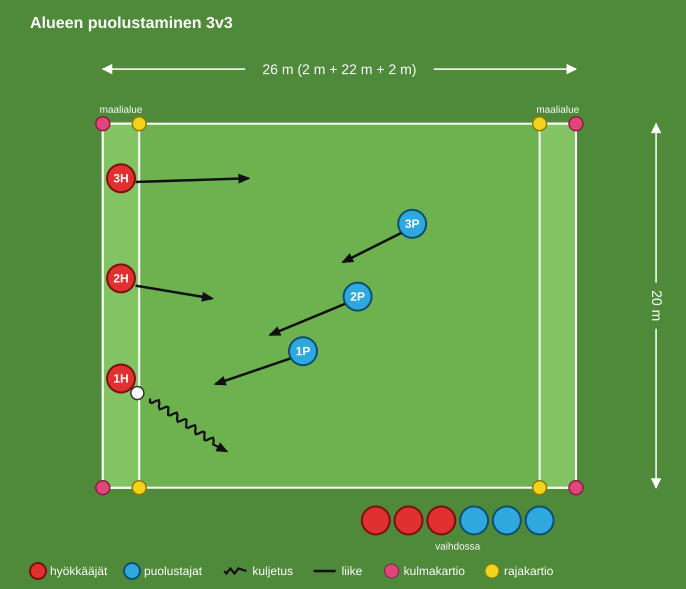

# Alueen puolustaminen 3v3

## Tavoite
Puolustajat oppivat jakamaan tehtävät kolmen pelaajan kesken: 1P painostaa
pallollista ja ohjaa hänet lähemmän sivurajan suuntaan, 2P sulkee syöttölinjan
lähimmälle hyökkääjälle ja varmistaa 1P:n takana, ja 3P pitää tasapainon
peittämällä tilan ja kauimmaisen hyökkääjän heikolla puolella. Riisto
ajoitetaan hyökkääjän virheeseen. Harjoite on jatkoa harjoitteelle Alueen
puolustaminen 2v2 (`alueen-puolustaminen-2v2`).

## Järjestelyt
- Suorakaiteen muotoinen alue 26 × 20 m: pelialue 22 m ja sen kummassakin
  päädyssä 2 m syvä maalialue koko alueen leveydeltä. Alue on 2v2-versiota
  pidempi ja leveämpi, jotta kolmella hyökkääjällä on tilaa syöttöpeliin ja
  3P:n täytyy hallita tila heikolla puolella.
- Sivuraja, jolle ohjataan, määräytyy sen mukaan, kummalla puolella aluetta
  pallo on: puolustajat ohjaavat pallollisen lähemmän sivurajan yli.
- Kuusi pelaajaa pelaa 3v3 ja muut odottavat vaihdossa alueen sivulla.
- 9–12 pelaajaa per suorituspaikka, joista 6 pelaa ja 3–6 on vaihdossa.
- Harjoitteen voi sijoittaa vasemmalle laitakaistalle (VLK), keskikaistalle (KK)
  tai oikealle laitakaistalle (OLK).
- Välineet: 8 kartiota (4 kulmiin, 4 maalialueiden rajoille), liivit, palloja.

## Kulku
1. Hyökkääjäkolmikko aloittaa pallon kanssa toisen päädyn maalialueelta ja
   hyökkää kohti vastakkaista päätyä. Puolustajat aloittavat pelialueen
   keskeltä.
2. Hyökkääjät saavat maalin, kun joku heistä pysäyttää pallon jalan alle
   maalialueella, kuljettaen tai syötöstä.
3. Puolustajat saavat pisteen, kun he ohjaavat hyökkääjän tai pallon lähemmän
   sivurajan yli tai riistävät pallon hallintaansa, myös syötönkatkolla.
4. Jokaisen tilanteen jälkeen hyökkäyssuunta vaihtuu kohti toista päätyä.
   Uusi tilanne alkaa heti, kun kaikki puolustajat ovat siirtyneet takaisin
   pelialueen sisään.
5. Roolit pysyvät samoina koko intervallin ajan. Kolmikot vaihdetaan
   intervallina, esim. 60 sekuntia peliä ja 60 sekuntia lepoa, ja roolit
   vaihtuvat seuraavaan intervalliin.

## Valmennuspisteet
Valitaan 1–2 kerrallaan.
- **1P:** nopea lähtö pallollista kohti ja jarrutus matalaan sivuasentoon ennen kaksinkamppailua.
- **1P:** tule pallollisen eteen sisäpuolelta, niin että ainoa vapaa suunta on lähempi sivuraja.
- **1P:** riisto vasta, kun hyökkääjä tekee virheen (liian pitkä kosketus, katse pallossa, huono asento).
- **2P:** asetu niin, että suljet syöttölinjan lähimmälle hyökkääjälle ja olet samalla 1P:n takana varmistamassa.
- **2P:** varmistusetäisyys on niin lyhyt, että ehdit väliin, jos 1P ohitetaan.
- **3P:** pysy heikolla puolella 2P:n takana ja sisäpuolella, niin että peität kauimmaisen hyökkääjän ja tilan maalialueen edessä.
- **3P:** älä nouse samalle linjalle 2P:n kanssa: kolmio 1P–2P–3P pitää puolustuksen syvänä.
- **1P, 2P, 3P:** kun pallo syötetään, roolit vaihtuvat: uutta pallollista lähin on 1P, hänen vierellään 2P ja kauimpana 3P.
- **1P, 2P, 3P:** puhukaa: kuka painostaa, kuka varmistaa, kuka pitää tasapainon.

## Onnistumisen mittari
Puolustajat vaihtavat 1P-, 2P- ja 3P-rooleja sujuvasti pallon liikkuessa, eikä
pitkä syöttö heikolle puolelle johda maaliin. Hyökkääjät joutuvat yhä useammin
sivurajan suuntaan tai menettävät pallon syötönkatkoon. Puolustajien pisteitä
lasketaan intervallin aikana.
