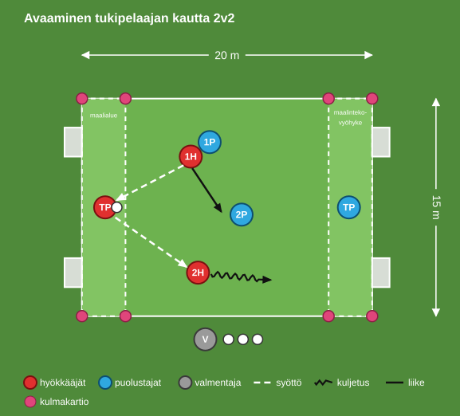

# Avaaminen tukipelaajan kautta 2v2

## Tavoite
Joukkue avaa pallon paineen alta pelaamalla sen taakse omalle tukipelaajalle,
joka kääntää pelin vapaalle puolelle. Tukipelaaja on joukkueen kolmas pelaaja,
joten pallollisella joukkueella on avauksessa ylivoima 3v2.

## Järjestelyt
- Kenttä 20 × 15 m, kummassakin päädyssä kaksi pikkumaalia.
- Kummankin päädyn eteen merkitään kartioilla 3 m syvä maalialue.
- Kummallakin joukkueella on kaksi kenttäpelaajaa ja tukipelaaja, joka pysyy
  oman maalialueensa sisällä. Yksi vaihtopelaaja kummallakin joukkueella.
- Valmentaja pallovaraston kanssa sivurajalla.

## Kulku
1. Peli alkaa aina tukipelaajalta: aluksi, maalin jälkeen ja kun pallo menee
   yli oman päätyrajan.
2. Kenttäpelaajat pelaavat koko kentällä 2v2. Pallollinen joukkue voi
   pelata pallon taakse omalle tukipelaajalleen, joka kääntää pelin.
3. Tukipelaaja ei puolusta. Puolustajat painostavat tukipelaajaa maalialueen
   rajalta.
4. Tukipelaaja saa nousta pallon kanssa pelialueelle. Silloin yksi oman
   joukkueen kenttäpelaajista siirtyy maalialueelle uudeksi tukipelaajaksi.
5. Maalin saa tehdä vain vastustajan maalialueelta.
6. Sivurajan ylityksen jälkeen peli jatkuu sivurajalta syöttämällä tai kuljettamalla.
7. Intervallit, esim. 5 × 2 min. Tukipelaaja ja vaihtopelaaja vaihtuvat
   intervallien välissä.

## Valmennuspisteet
- **1H:** kun eteenpäin ei aukea, pelaa pallo taakse tukipelaajalle ja liiku
  heti uuteen syöttökulmaan.
- **2H:** hakeudu pallosta poispäin vastakkaiselle puolelle, jotta
  pelinkäännölle on kohde, ja ota ensimmäinen kosketus eteenpäin.
- **Tukipelaaja:** tarkista vapaa tila ennen vastaanottoa ja käännä peli
  1–2 kosketuksella vapaalle puolelle. Jos edessä on vapaata tilaa, nouse
  pallon kanssa pelialueelle.
- **Lähin kenttäpelaaja:** kun tukipelaaja nousee pallon kanssa, siirry heti
  maalialueelle uudeksi tukipelaajaksi.
- **1P, 2P:** 1P painostaa pallollista ja ohjaa peliä, 2P peittää
  kääntösyötön kohteen. Asetu nopeasti uudelleen pelinkäännön jälkeen.

## Onnistumisen mittari
Joukkue pelaa paineen alta taakse tukipelaajalle eikä menetä palloa, ja
pelinkäännöt tukipelaajan kautta vievät pallon vastustajan puoliskolle.
