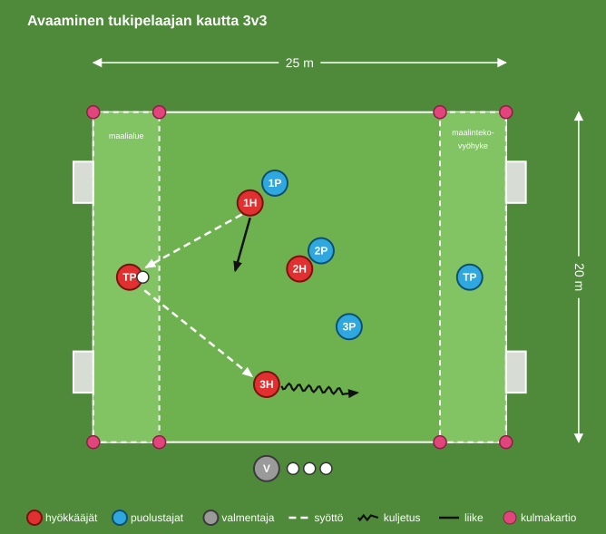

# Avaaminen tukipelaajan kautta 3v3

## Tavoite
Joukkue avaa pallon paineen alta pelaamalla sen taakse omalle tukipelaajalle,
joka kääntää pelin vapaalle puolelle. Kenttäpelaajat liikkuvat heti uusiin
syöttökulmiin ja antavat pelille leveyttä.

## Järjestelyt
- Kenttä 25 × 20 m, kummassakin päädyssä kaksi pikkumaalia.
- Kummankin päädyn eteen merkitään kartioilla 4 m syvä maalialue.
- Kummallakin joukkueella on kolme kenttäpelaajaa ja tukipelaaja, joka pysyy
  oman maalialueensa sisällä. Yksi vaihtopelaaja kummallakin joukkueella.
- Valmentaja pallovaraston kanssa sivurajalla.

## Kulku
1. Peli alkaa aina tukipelaajalta: aluksi, maalin jälkeen ja kun pallo menee
   yli oman päätyrajan.
2. Kenttäpelaajat pelaavat koko kentällä 3v3. Pallollinen joukkue voi
   pelata pallon taakse omalle tukipelaajalleen, joka kääntää pelin.
3. Tukipelaaja ei puolusta. Puolustajat painostavat tukipelaajaa maalialueen
   rajalta.
4. Tukipelaaja saa nousta pallon kanssa pelialueelle. Silloin yksi oman
   joukkueen kenttäpelaajista siirtyy maalialueelle uudeksi tukipelaajaksi.
5. Maalin saa tehdä vain vastustajan maalialueelta.
6. Sivurajan ylityksen jälkeen peli jatkuu sivurajalta syöttämällä tai kuljettamalla.
7. Intervallit, esim. 4 × 3 min. Tukipelaaja ja vaihtopelaaja vaihtuvat
   intervallien välissä.

## Valmennuspisteet
- **1H:** kun eteenpäin ei aukea, pelaa pallo taakse tukipelaajalle ja liiku
  heti uuteen syöttökulmaan.
- **2H:** tue pallollista syöttökulmassa avoimella vartalolla, jotta pystyt
  jatkamaan peliä eteenpäin.
- **3H:** anna leveyttä vastakkaisella puolella, jotta pelinkäännölle on kohde.
- **Tukipelaaja:** tarkista vapaa tila ennen vastaanottoa ja käännä peli
  1–2 kosketuksella vapaalle puolelle. Jos edessä on vapaata tilaa, nouse
  pallon kanssa pelialueelle.
- **Lähin kenttäpelaaja:** kun tukipelaaja nousee pallon kanssa, siirry heti
  maalialueelle uudeksi tukipelaajaksi.
- **1P, 2P, 3P:** siirry pallon puolelle, painosta tukipelaajaa niin, ettei
  kääntösyöttö onnistu, ja asetu nopeasti uudelleen pelinkäännön jälkeen.

## Onnistumisen mittari
Joukkue pelaa paineen alta taakse tukipelaajalle eikä menetä palloa, ja
pelinkäännöt tukipelaajan kautta vievät pallon vastustajan puoliskolle.
