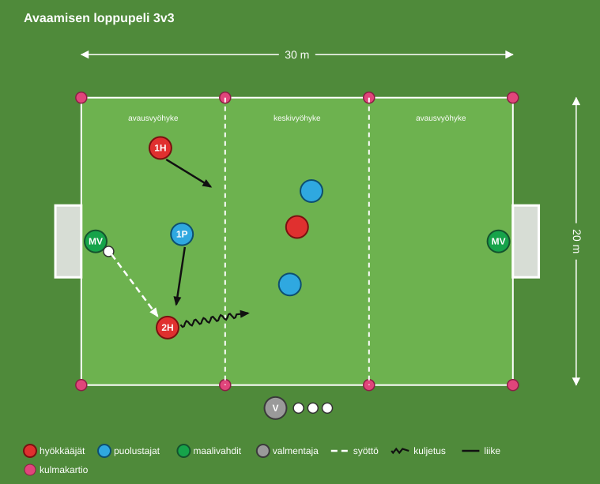

# Avaamisen loppupeli 3v3

## Tavoite
Harjoituksen teema siirretään peliin: jokainen hyökkäys alkaa maalivahdilta,
ja joukkue avaa pallon omalta vyöhykkeeltä ylivoimalla 2v1 yhtä prässääjää
vastaan ennen kuin peli vapautuu.

## Järjestelyt
- Kenttä 30 × 20 m, isot maalit päädyissä. Kenttä jaetaan kartioilla
  kolmeen 10 m vyöhykkeeseen: avausvyöhyke kummassakin päässä ja
  keskivyöhyke.
- Kummallakin joukkueella on maalivahti ja kolme kenttäpelaajaa (MV + 3v3).
  Yksi vaihtopelaaja kummallakin joukkueella.
- Valmentaja pallovaraston kanssa sivurajalla.

## Kulku
1. Jokainen tilanne alkaa maalivahdilta: aluksi, maalin jälkeen ja kun pallo
   menee yli päätyrajan.
2. Aloituksessa avaavan joukkueen kaksi kenttäpelaajaa on avausvyöhykkeellä
   ja yksi keskivyöhykkeellä.
3. Puolustavasta joukkueesta vain yksi prässääjä saa tulla avausvyöhykkeelle
   ennen maalivahdin ensimmäistä syöttöä. Kaksi muuta odottaa keskivyöhykkeellä.
4. Kun maalivahti on syöttänyt, peli on vapaa ja kaikki saavat liikkua
   kaikilla vyöhykkeillä.
5. Sivurajan ylityksen jälkeen peli jatkuu sivurajalta syöttämällä tai kuljettamalla.
6. Intervallit, esim. 4 × 3 min. Vaihtopelaaja tulee peliin intervallien välissä.

## Valmennuspisteet
- **MV:** katso ennen syöttöä, kumpi pelaaja on vapaa prässääjän varjosta,
  ja syötä hänen etummaiselle jalalleen.
- **1H, 2H:** levittäydy avausvyöhykkeen leveyteen niin, ettei prässääjä
  peitä molempia yhtä aikaa, ja ota ensimmäinen kosketus eteenpäin.
- **1H, 2H:** kun prässääjä tulee, pelaa ylivoima loppuun: syötä vapaalle
  tai kuljeta pallo keskivyöhykkeelle.
- **Keskivyöhykkeen pelaaja:** liiku pois puolustajan varjosta, jotta pallo
  voidaan pelata suoraan keskivyöhykkeelle. Kun pallollinen etenee
  keskivyöhykkeelle, suuntaa juoksu eteenpäin vastustajan maalia kohti.
- **1P:** prässää kaarella niin, että peität toisen syöttölinjan ja ohjaat
  pallon sivurajaa kohti.

## Onnistumisen mittari
Joukkue saa pallon maalivahdilta keskivyöhykkeelle hallitusti useammin kuin
harjoituksen alussa, ja avauksista syntyy hyökkäyksiä vastustajan päätyyn.
