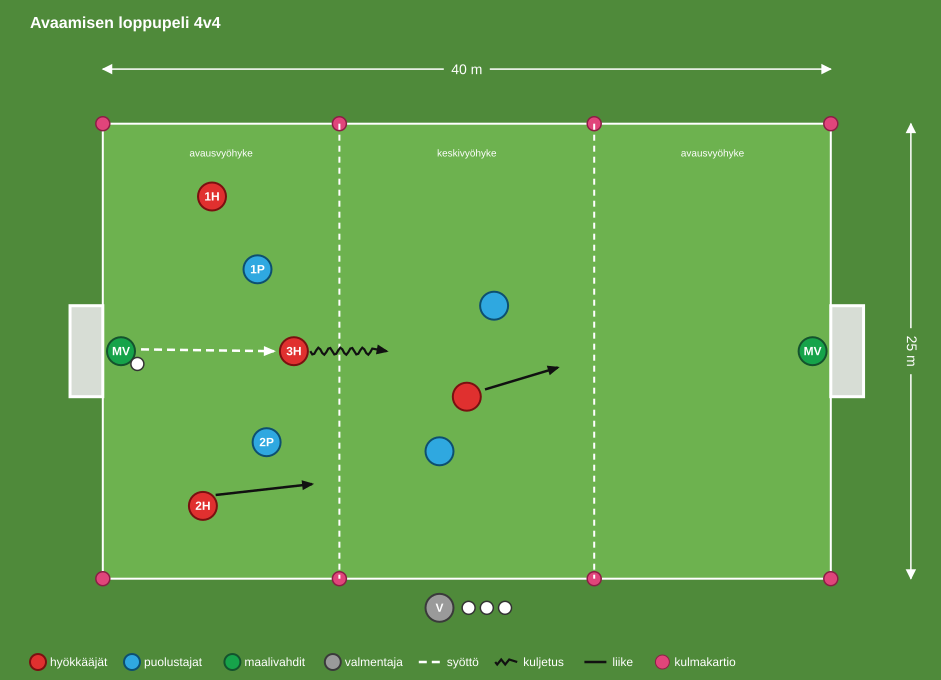

# Avaamisen loppupeli 4v4

## Tavoite
Harjoituksen teema siirretään peliin: jokainen hyökkäys alkaa maalivahdilta,
ja joukkue avaa pallon omalta vyöhykkeeltä ylivoimalla 3v2 kahta prässääjää
vastaan ja vie sen hallitusti keskivyöhykkeelle.

## Järjestelyt
- Kenttä 40 × 25 m, isot maalit päädyissä. Kenttä jaetaan kartioilla
  kolmeen vyöhykkeeseen: 13 m avausvyöhyke kummassakin päässä ja 14 m
  keskivyöhyke.
- Kummallakin joukkueella on maalivahti ja neljä kenttäpelaajaa (MV + 4v4).
  Yksi vaihtopelaaja kummallakin joukkueella.
- Valmentaja pallovaraston kanssa sivurajalla.

## Kulku
1. Jokainen tilanne alkaa maalivahdilta: aluksi, maalin jälkeen ja kun pallo
   menee yli päätyrajan.
2. Aloituksessa avaavan joukkueen kolme kenttäpelaajaa on avausvyöhykkeellä
   ja yksi keskivyöhykkeellä.
3. Puolustavasta joukkueesta vain kaksi prässääjää saa tulla avausvyöhykkeelle
   ennen maalivahdin ensimmäistä syöttöä. Kaksi muuta odottaa keskivyöhykkeellä.
4. Kun maalivahti on syöttänyt, peli on vapaa ja kaikki saavat liikkua
   kaikilla vyöhykkeillä.
5. Maali on yksi piste. Hallittu avaus on myös piste: pallo syötetään
   keskivyöhykkeelle omalle pelaajalle, joka saa sen haltuunsa, tai se
   kuljetetaan vyöhykkeen rajan yli.
6. Sivurajan ylityksen jälkeen peli jatkuu sivurajalta syöttämällä tai kuljettamalla.
7. Intervallit, esim. 4 × 4 min. Vaihtopelaaja tulee peliin intervallien välissä.

## Valmennuspisteet
- **MV:** katso ennen syöttöä, kuka on vapaa prässääjien varjosta, ja syötä
  hänen etummaiselle jalalleen.
- **1H:** jos prässääjä tulee, pelaa ylivoima loppuun: syötä vapaalle tai
  kuljeta tilaan, jonka prässääjä jätti.
- **2H:** tarjoudu syöttökulmaan pallollisen viereen, jotta 1H:lla on aina
  turvallinen vaihtoehto.
- **3H:** anna leveyttä ja syvyyttä vastakkaisella puolella, jotta peli
  voidaan kääntää pois paineesta.
- **Keskivyöhykkeen pelaaja:** liiku pois puolustajan varjosta, jotta pallo
  voidaan pelata linjojen läpi. Kun pallollinen etenee keskivyöhykkeelle,
  suuntaa juoksu eteenpäin vastustajan maalia kohti.
- **1P, 2P:** 1P prässää kaarella ja peittää syöttölinjan, 2P peittää
  lähimmän vapaan pelaajan ja ohjaa peliä sivurajaa kohti.

## Onnistumisen mittari
Joukkue kerää avauspisteitä useammin kuin harjoituksen alussa, ja
hallituista avauksista syntyy hyökkäyksiä vastustajan päätyyn.
