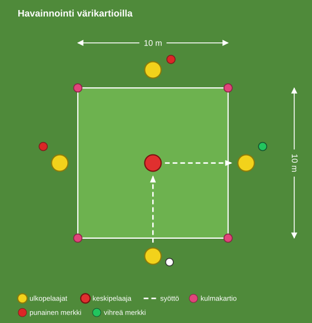

# Havainnointi värikartioilla

## Tavoite
Keskipelaaja oppii havainnoimaan ympäristönsä mahdollisimman nopeasti, sivuille
ja olan yli taakse, ennen kuin pallo tulee. Hän tekee päätöksen syöttösuunnasta
jo ennen vastaanottoa ja asettaa vartalonsa niin, että näkee pallon ja muut
pelaajat yhtä aikaa.

## Järjestelyt
- Alue noin 10 × 10 m, kulmissa kartiot.
- 5 pelaajaa: 4 ulkopelaajaa alueen ulkopuolella sivujen keskellä ja
  1 keskipelaaja alueen keskellä.
- Jokaisella ulkopelaajalla on kädessään punainen ja vihreä lautaskartio.
- Pallo on yhdellä ulkopelaajalla.
- Välineet: 4 kartiota, 4 punaista ja 4 vihreää lautaskartiota, palloja.

## Kulku
1. Pallollinen ulkopelaaja syöttää keskipelaajalle.
2. Kolme muuta ulkopelaajaa pitävät ylhäällä joko punaista tai vihreää kartiota.
3. Keskipelaaja havainnoi kaikki kolme ja syöttää säännön mukaan:
   - Kaikilla kolmella on sama väri → pallo takaisin syöttäjälle.
   - Kahdella on sama väri → pallo sille, jolla on eri väri.
4. Aina kun keskipelaaja syöttää, muut ulkopelaajat valitsevat värin uudelleen
   kukin oman valintansa mukaan, eivät kaikki samalla tavalla.
5. Pallon saanut ulkopelaaja syöttää seuraavan pallon keskipelaajalle.
6. Keskipelaaja vaihtuu noin minuutin välein.

## Valmennuspisteet
Valitaan 1–2 kerrallaan.
- **Keskipelaaja:** havainnoi ympäristö mahdollisimman nopeasti: vilkaise
  sivuille ja olan yli taakse jo ennen kuin pallo lähtee.
- **Keskipelaaja:** tarkista uudelleen pallon ollessa matkalla, jotta näet
  viimeisimmän tilanteen.
- **Keskipelaaja:** ota puoliavoin asento, jossa näet syöttäjän ja mahdollisimman
  suuren osan ympäristöstä yhtä aikaa.
- **Keskipelaaja:** päätä syöttösuunta ennen vastaanottoa ja ohjaa ensimmäinen
  kosketus sitä kohti.
- **Ulkopelaajat:** pidä kartio korkealla ja valitse väri arvaamattomasti,
  älä vain vaihda aina toiseen väriin.

## Onnistumisen mittari
Keskipelaaja syöttää oikealle pelaajalle yhä useammin kahdella kosketuksella,
eikä hänen tarvitse pysähtyä katsomaan pallon saatuaan.
