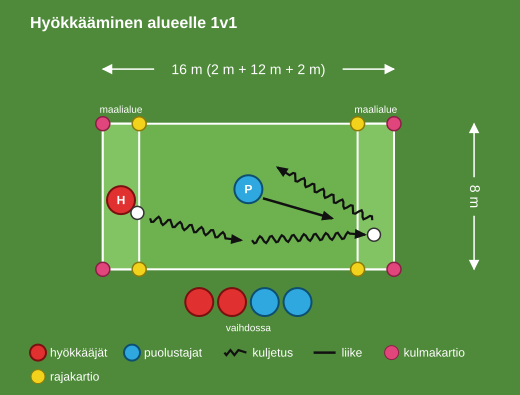

# Hyökkääminen alueelle 1v1

## Tavoite
Hyökkääjä oppii hyökkäämään puolustajaa kohti, ohittamaan hänet kuljettaen ja
pitämään pallon hallinnassa ohituksen jälkeen. Puolustaja oppii palaamaan
nopeasti pallon ja maalialueen väliin, jarruttamaan ennen kaksinkamppailua ja
estämään läpimurron.

## Järjestelyt
- Suorakaiteen muotoinen alue 16 × 8 m: pelialue 12 m ja sen kummassakin
  päädyssä 2 m syvä maalialue koko alueen leveydeltä.
- Kaksi pelaajaa pelaa 1v1 ja muut odottavat vaihdossa alueen sivulla.
- 4–6 pelaajaa per suorituspaikka, joista 2 pelaa ja 2–4 on vaihdossa.
  Useita suorituspaikkoja mahtuu rinnakkain 8v8-kentälle (60 × 40 m).
- Harjoitteen voi sijoittaa vasemmalle laitakaistalle (VLK), keskikaistalle (KK)
  tai oikealle laitakaistalle (OLK).
- Välineet: 8 kartiota (4 kulmiin, 4 maalialueiden rajoille), liivit, palloja.

## Kulku
1. Hyökkääjä aloittaa pallon kanssa toisen päädyn maalialueelta ja hyökkää
   kohti vastakkaista päätyä. Puolustaja aloittaa pelialueen keskeltä.
2. Hyökkääjä yrittää kuljettaa puolustajan ohi maalialueelle.
3. Maali syntyy, kun hyökkääjä pysäyttää pallon jalan alle maalialueella.
4. Maalin jälkeen hyökkääjän hyökkäyssuunta vaihtuu kohti toista päätyä.
   Uusi tilanne alkaa heti, kun puolustaja on siirtynyt takaisin pelialueen
   sisään.
5. Jos puolustaja voittaa pallon, roolit vaihtuvat ja uusi hyökkääjä hyökkää
   kumpaan tahansa päätyyn.
6. Pelaajat vaihdetaan intervallina, esim. 30 sekuntia peliä ja 30 sekuntia
   lepoa.

## Valmennuspisteet
Valitaan 1–2 kerrallaan.
- **1H:** hyökkää puolustajaa kohti vauhdilla, jotta hänen on pakko pysähtyä.
- **1H:** harhautus ajoissa ja kiihdytys ohituksen jälkeen.
- **1H:** pallo lähellä jalkaa maalialueelle tultaessa, jotta pysäytys onnistuu hallitusti.
- **1H:** käänny maalin jälkeen nopeasti ja hyökkää heti, kun puolustaja tulee alueelle.
- **1P:** paluu maalin jälkeen nopeasti pallon ja maalialueen väliin.
- **1P:** jarrutus ja matala asento ennen kaksinkamppailua.
- **1P:** ohjaa hyökkääjä kohti sivurajaa, pois maalialueen keskeltä.

## Onnistumisen mittari
Hyökkääjät hyökkäävät puolustajaa kohti ja ohittavat hänet vauhdilla eivätkä
pysähdy pallon kanssa. Puolustajat palaavat nopeasti ja pakottavat yhä
useamman hyökkääjän sivulle ennen maalialuetta. Maaleja lasketaan intervallin
aikana.
