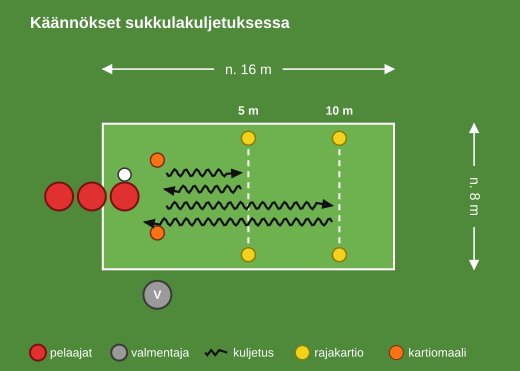

# Käännökset sukkulakuljetuksessa

## Tavoite
Pelaaja oppii kääntämään suunnan pallon kanssa täydessä vauhdissa: hän
jarruttaa pallon lähelle, kääntää sen 180 astetta yhdellä kosketuksella ja
kiihdyttää heti uuteen suuntaan.

## Järjestelyt
- Kaista noin 16 × 8 m.
- Lähtö- ja maaliportti noin 4 metrin levyinen. Kääntöviivat 5 ja 10 metrin
  päähän portista, kumpikin merkitty kahdella kartiolla.
- 4 pelaajaa suorituspaikalla, jokaisella oma pallo. Isommalle ryhmälle tehdään
  toinen kaista viereen.
- Välineet: pallo jokaiselle, 6 kartiota, sekuntikello.

## Kulku
1. Jonon ensimmäinen lähtee omasta aloitteestaan ja kuljettaa pallon
   5 metrin viivalle.
2. Hän kääntää pallon viivan takaa 180 astetta ja kuljettaa takaisin
   lähtöviivalle.
3. Lähtöviivalla hän kääntää uudelleen ja kuljettaa 10 metrin viivalle.
4. Kolmannen käännöksen jälkeen hän kuljettaa täysillä maaliin portin läpi.
   Suoritus on noin 30 metriä ja kolme käännöstä.
5. Seuraava lähtee, kun edellinen on tullut maaliin. Suorittaja palaa jonon
   perälle ja palautuu, kunnes on taas vuorossa.
6. Valmentaja määrää käännöstavan kierroksittain, esimerkiksi sisäsyrjä,
   ulkosyrjä, pohjaveto ja Cruyff-käännös, ja kääntöjalka vaihtuu joka
   kierroksella. Lopuksi otetaan 2–3 kierrosta aikaa vastaan, ja pelaaja
   yrittää parantaa omaa aikaansa.

## Valmennuspisteet
Valitaan 1–2 kerrallaan.
- Lyhennä kosketuksia ennen viivaa, jotta pallo on lähellä jarrutuksessa.
- Laske painopistettä ja jarruta tukijalalla pallon viereen.
- Käännä pallo yhdellä kosketuksella niin, että se jää lähelle eikä karkaa.
- Kiihdytä heti käännöksen jälkeen: ensimmäinen kosketus vie palloa uuteen suuntaan.
- Nosta katse käännöksen jälkeen ennen seuraavaa viivaa.
- Tee käännös vuorotellen kummallakin jalalla ja kumpaankin suuntaan.

## Onnistumisen mittari
Pelaaja kääntää pallon viivan takaa ilman ylimääräisiä kosketuksia, pallo
pysyy käännöksissä lähellä ja aika paranee kierros kierrokselta myös
heikommalla jalalla tehdyissä käännöksissä.
