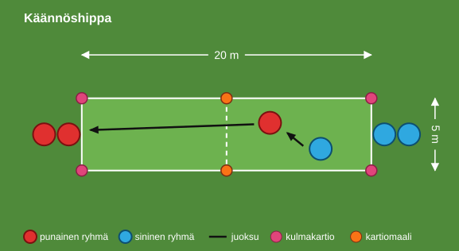

# Käännöshippa

## Tavoite
Pelaaja kehittää lähtönopeutta, kiihdytystä ja kääntymistä täydestä
vauhdista. Hän joutuu samalla tarkkailemaan vastustajaa ja valitsemaan
oikean hetken ja reitin, jotta saa hipattua vastustajan mutta ei jää
itse hipatuksi.

## Järjestelyt
- Suorakaiteen muotoinen alue 20 × 5 m merkitään kulmakartioilla.
  Alueen puoliväliin tehdään sivurajoille kahdesta kartiosta alueen
  levyinen, 5 m leveä porttimaali.
- Pelaajat jaetaan kahteen ryhmään liiveillä, esimerkiksi 10 pelaajaa,
  5 + 5. Ryhmät asettuvat jonoon alueen vastakkaisiin päätyihin ja
  lähtevät päädystä. Isommalle ryhmälle tehdään toinen alue viereen.
- Välineet: 6 kartiota, liivit.

## Kulku
1. Kummankin ryhmän oma puolisko on se alueen puoli, jolla sen jono on.
   Vastustajan voi hipata kaikkialla alueella.
2. Punaisen jonon ensimmäinen lähtee omasta aloitteestaan ja juoksee
   portin läpi vastustajan puoliskolle. Sinisen jonon ensimmäinen saa
   lähteä liikkeelle vasta, kun punainen on läpäissyt portin.
3. Jokaisen pelaajan on käytävä kääntymässä vastustajan puoliskolla ja
   palattava portin läpi omaan jonoonsa. Jonoon palannut antaa läpyn jonon
   seuraavalle, joka saa lähteä vasta läpyn jälkeen. Harjoite rullaa
   näin jatkuvana.
4. Vastustajan hippaaminen tuo ryhmälle pisteen. Hipatun ryhmän seuraava
   pelaaja saa lähteä liikkeelle heti ilman läpyä. Hipattu pelaaja palaa
   alueen ulkopuolelta jononsa perälle, ja hipannut pelaaja jatkaa peliä.
5. Pelaaja voi valita, mitä tekee: yrittää hipata vastustajaa, houkutella
   vastustajan lähemmäs omaa jonoa, jotta joukkuekaveri pääsee hippaamaan,
   tai kääntyä heti takaisin ja vaihtaa läpyllä uuden pelaajan peliin.
   Syvälle vastustajan puoliskolle juokseminen on riski.
6. Peliä pelataan esimerkiksi 2–3 minuutin jaksoissa, joiden välissä on
   palautus. Eniten pisteitä kerännyt ryhmä voittaa.

## Valmennuspisteet
Valitaan 1–2 kerrallaan.
- Lähde räjähtävästi heti läpyn jälkeen: matala asento ja lyhyet,
  nopeat ensiaskeleet.
- Käänny tiukasti ja matalana ja kiihdytä heti
  takaisin kohti porttia.
- Pidä katse vastustajassa ja arvioi riski ennen kuin juokset syvälle
  vastustajan puoliskolle.
- Houkuttele vastustaja lähemmäs omaa jonoa, jotta joukkuekaveri saa
  hipattua hänet.
- Kun olet väsynyt tai tilanne on huono, käänny heti ja vaihda uusi
  pelaaja peliin läpyllä.

## Onnistumisen mittari
Pelaajat lähtevät liikkeelle viiveettä läpyn jälkeen, juoksevat
täydellä vauhdilla ja tekevät ratkaisuja vastustajan sijainnin mukaan:
he hippaavat, houkuttelevat tai vaihtavat pelaajaa oikealla hetkellä.
