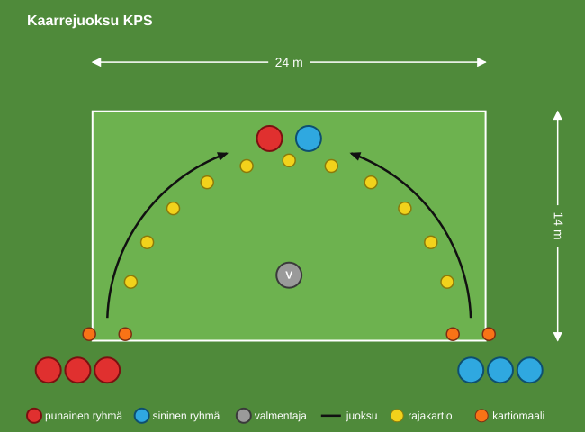

# Kaarrejuoksu KPS

## Tavoite
Pelaaja kehittää lähtönopeutta, kiihdytystä ja kaarrejuoksua sekä
pysähtymistä täydestä vauhdista. Kivi-paperi-sakset-kisa pakottaa
pelaajan pysähtymään ja lähtemään uudelleen liikkeelle heti tuloksen
selvittyä.

## Järjestelyt
- Kartiot asetetaan puolikaaren muotoon 2–3 metrin välein. Kaaren
  halkaisija on noin 20 m, jolloin radan pituus on noin 30 m.
- Kaaren molempiin päihin tehdään porttimaali kahdesta kartiosta kaaren
  ulkopuolelle, jolloin juoksulinja kulkee kaaren ulkoreunaa pitkin.
- Pelaajat jaetaan kahteen ryhmään liiveillä, esimerkiksi 10 pelaajaa,
  5 + 5. Ryhmät asettuvat jonoon oman porttimaalinsa taakse kaaren
  vastakkaisiin päihin. Isommalle ryhmälle tehdään toinen rata viereen.
- Välineet: 15 kartiota, liivit.

## Kulku
1. Kierros alkaa, kun kummankin jonon ensimmäinen lähtee yhtä aikaa
   liikkeelle oman porttimaalinsa läpi ja juoksee kaaren ulkoreunaa
   pitkin kohti vastustajan päätä. Kartioiden sisäpuolelta ei saa oikaista.
2. Kun pelaajat kohtaavat radalla, he pysähtyvät kasvokkain ja pelaavat
   kivi-paperi-sakset.
3. Hävinnyt poistuu radalta ja palaa oman jononsa perälle. Voittaja
   jatkaa juoksua samaan suuntaan.
4. Hävinneen ryhmän jonosta lähtee uusi pelaaja liikkeelle heti kisan
   päätteeksi, ja hän juoksee voittajaa vastaan. Kohdatessa pelataan taas
   kivi-paperi-sakset.
5. Kun pelaaja pääsee vastustajan päässä olevan porttimaalin läpi, hänen
   ryhmänsä saa pisteen. Pelaaja palaa oman jononsa perälle.
6. Kierros alkaa alusta: kummankin jonon ensimmäinen lähtee taas yhtä
   aikaa. Eniten pisteitä kerännyt ryhmä voittaa.

## Valmennuspisteet
Valitaan 1–2 kerrallaan.
- Lähde räjähtävästi: matala asento ja lyhyet, nopeat ensiaskeleet.
- Kaarteessa nojaa sisäänpäin ja juokse tiukasti kartioiden ulkoreunaa.
- Pysähdy hallitusti matalalla painopisteellä, jotta pääset heti
  uudelleen liikkeelle.
- Uusi lähtijä: seuraa kisaa ja lähde heti, kun tulos on selvä.
- Voittaja: kiihdytä heti uudelleen täyteen vauhtiin.

## Onnistumisen mittari
Pelaajat juoksevat koko matkan täydellä vauhdilla, pysähtyvät
kohtaamisessa hallitusti ja lähtevät heti uudelleen liikkeelle, eikä
radalle synny odottelua.
