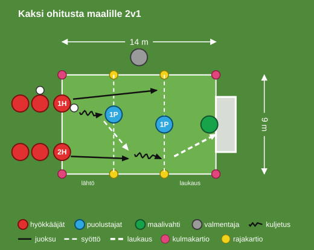

# Kaksi ohitusta maalille 2v1

## Tavoite
Hyökkääjäpari oppii ohittamaan puolustajan 2v1-ylivoimalla kahdesti peräkkäin
ja tekemään syötön tai kuljetuksen ratkaisun kummallakin kerralla puolustajan
sijainnin mukaan. Pallottomana oleva hyökkääjä oppii liikkumaan leveyteen tai
syvyyteen pois puolustajan varjosta. Puolustajat oppivat peittämään
syöttölinjan ja hidastamaan pallollista sitoutumatta liian aikaisin.

## Järjestelyt
- Alue 14 × 9 m (pituus maaliin 14 m, leveys 9 m).
- Alue jaetaan sivujen kartioilla kolmeen noin 4,5 metrin vyöhykkeeseen.
- Alueen päässä on iso maali ja maalivahti.
- Kaksi puolustajaa, yksi kummallakin vyöhykerajalla. Hyökkääjäparit
  jonottavat palloineen alueen ulkopuolella ensimmäisen vyöhykkeen reunan
  takana. Valmentaja seisoo
  sivurajalla.
- 4–8 kenttäpelaajaa ja maalivahti suorituspaikkaa kohden. Isommalle ryhmälle
  tehdään toinen suorituspaikka viereen. Kolme suorituspaikkaa mahtuu
  rinnakkain 8v8-kentälle (60 × 40 m): kentän pituus jaetaan kolmeen 20 metrin
  kaistaan, ja kunkin kaistan pituussuunnasta jää tilaa jonoille.
- Välineet: iso maali (esim. 5v5-maali), 8 kartiota (4 kulmiin, 4
  vyöhykerajoille), liivit, palloja.

## Kulku
1. Jonon ensimmäinen hyökkääjäpari lähtee omasta aloitteestaan pallon kanssa
   liikkeelle ensimmäisen vyöhykkeen reunalta.
2. Ensimmäinen puolustaja puolustaa lähempää vyöhykerajaa. Hyökkääjät
   ohittavat hänet 2v1-tilanteessa kuljettamalla tai syöttämällä.
3. Toinen puolustaja puolustaa kauempaa vyöhykerajaa. Hyökkääjät ohittavat
   hänetkin 2v1-tilanteessa.
4. Maalin puoleisessa vyöhykkeessä hyökkääjät laukaisevat maalivahtia vastaan.
5. Puolustajat pysyvät omalla vyöhykerajallaan. Jos puolustaja riistää pallon,
   hän tekee vastahyökkäyksen ja yrittää kuljettaa pallon ulos edessään
   olevien vyöhykkeiden reunoilta. Seuraava pari lähtee, kun edellinen
   hyökkäys on päättynyt.
6. Puolustajat vaihdetaan 3 minuutin välein.

## Valmennuspisteet
Valitaan 1–2 kerrallaan.
- **1H ja 2H:** maalintekoon mahdollisimman nopeasti, kumpikin ohitus
  mahdollisimman vähillä kosketuksilla.
- **1H:** syötetäänkö vai kuljetetaanko – ratkaisu tehdään kahdesti, kumpikin
  kerta puolustajan sijainnin mukaan.
- **2H:** liiku leveyteen tai syvyyteen pois puolustajan varjosta.
- **1H ja 2H:** laukaus heti, kun viimeinen puolustaja on ohitettu.
- **1P:** asetu niin, että syöttölinja on varjossa.
- **1P:** hidasta pallollista sitoutumatta liian aikaisin.
- **1P riiston jälkeen:** vastahyökkäys heti ulos edessä olevien vyöhykkeiden reunoilta.
- **1P (ensimmäinen puolustaja):** ohjaa pallollinen toisen puolustajan puolelle.
- **Maalivahti:** ohjaa viimeistä puolustajaa ja ottaa laukaisijan.

## Onnistumisen mittari
Parit pääsevät molempien vyöhykerajojen yli pysähtymättä, ja ratkaisu
(syöttö tai kuljetus) vaihtelee puolustajan sijainnin mukaan eikä ole sama
joka kerta. Puolustajat saavat yhä useammin pallollisen ratkaisemaan itse.
