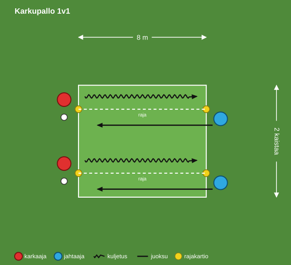

# Karkupallo 1v1

## Tavoite
Pelaaja oppii kuljettamaan palloa kovassa vauhdissa, kääntymään tiukasti
kartion ympäri ilman että vauhti hidastuu ja kiihdyttämään heti käännöksen
jälkeen. Jahtaaja oppii kiertämään kartiot lyhintä reittiä ja kiihdyttämään
täysillä.

## Järjestelyt
- Kaksi kartiota 8 metrin päässä toisistaan, ja niiden välissä on raja, jonka
  yli ei saa oikaista. Kaistan leveys on noin 2 m.
- Pelataan pareittain koko ryhmällä yhtä aikaa. Kaistat asetetaan rinnakkain
  2–3 metrin välein.
- Välineet: 2 kartiota ja pallo jokaiselle parille.

## Kulku
1. Pallollinen pelaaja (karkaaja) aloittaa toiselta kartiolta ja jahtaaja
   vastakkaiselta kartiolta.
2. Karkaaja lähtee omasta aloitteestaan, ja jahtaaja lähtee samalla hetkellä.
   Molemmat kiertävät kartioita samaan suuntaan.
3. Karkaaja kuljettaa palloa molemmat kartiot kiertäen ja yrittää pysyä
   karussa. Jahtaaja yrittää koskettaa karkaajaa. Kummankin on kierrettävä
   kartiot, eikä rajan yli saa oikaista.
4. Kun jahtaaja koskettaa karkaajaa, pallo vaihtaa omistajaa. Molemmat
   palaavat alueen päätyihin lähtökartioille, ja uusi karkaaja lähtee pallon
   kanssa omasta aloitteestaan uudelleen.
5. Kierros kestää minuutin. Se, jolla pallo on kierroksen lopussa, voittaa.
6. Kierrosten välissä on lyhyt tauko, ja parit vaihdetaan.

## Valmennuspisteet
Valitaan 1–2 kerrallaan.
- **Karkaaja:** pallo lähellä jalkaa kartion kierrossa ja tiukka käännös ilman
  vauhdin hidastumista.
- **Karkaaja:** pidempi kosketus ja kiihdytys suoralla.
- **Karkaaja:** katse ylös – missä jahtaaja on.
- **Jahtaaja:** lyhyt reitti kartion ympäri ja tiukka käännös.
- **Jahtaaja:** täysi kiihdytys suoralla, ei hölkkäämistä kartioiden välissä.

## Onnistumisen mittari
Pelaajat kiertävät kartiot tiukasti pallo hallinnassa, eikä vauhti hidastu
käännöksissä. Jahtaajat saavat karkaajan kiinni yhä useammin kiertämällä
kartiot tiukasti.
