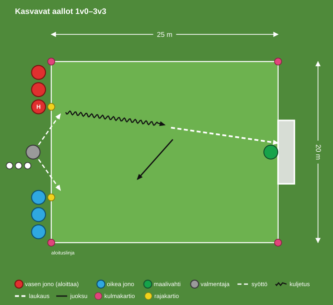

# Kasvavat aallot 1v0–3v3

## Tavoite
Hyökkääjät oppivat murtautumaan maalille ja viimeistelemään nopeasti
tilanteissa, joissa pelaajamäärä kasvaa aalto aallolta 1v0:sta 3v3:een.
Jokaisen aallon jälkeen pelaajan rooli vaihtuu: kun oma jono hyökkää, hän
on hyökkääjä, ja kun toinen jono hyökkää, hän on puolustaja. Pelaajat
oppivat siirtymään viiveettä hyökkäämisestä puolustamiseen ja takaisin.

## Järjestelyt
- Alue 25 × 20 m (pituus maaliin 25 m, leveys 20 m). Alueen päässä on iso
  maali ja maalivahti.
- Vastakkaisessa päässä on aloituslinja. Kaksi jonoa (eriväriset liivit)
  asettuu aloituslinjan taakse noin 10 metrin päähän toisistaan, vasen ja
  oikea jono hyökkäyssuuntaan katsottuna.
- Valmentaja seisoo jonojen välissä pallovaraston kanssa.
- 6–10 kenttäpelaajaa ja maalivahti suorituspaikkaa kohden, vähintään kolme
  pelaajaa kummassakin jonossa. Isommalle ryhmälle tehdään toinen
  suorituspaikka viereen.
- Välineet: iso maali, 6 kartiota (4 kulmiin, 2 jonojen lähtöpaikoiksi),
  liivit kahdessa värissä, palloja.

## Kulku
1. **1v0:** Valmentaja syöttää vasemman jonon ensimmäiselle pelaajalle. Hän
   kuljettaa maalille ja laukaisee.
2. **1v1:** Laukauksen jälkeen pelaaja jää kentälle ja siirtyy heti
   puolustamaan. Valmentaja syöttää seuraavan pallon oikean jonon
   ensimmäiselle pelaajalle, joka hyökkää maalille.
3. **2v1:** Valmentaja syöttää seuraavan pallon vasempaan jonoon. Uusi
   pelaaja ja kentällä jo oleva vasemman jonon pelaaja hyökkäävät, ja oikean
   jonon pelaaja puolustaa.
4. **2v2, 3v2, 3v3:** Aallot jatkuvat samalla tavalla. Valmentaja syöttää
   aina seuraavan pallon seuraavana hyökkäysvuorossa olevaan jonoon, ja
   jonosta tulee yksi pelaaja lisää. Kentällä olevat pelaajat hyökkäävät,
   kun oman jonon pelaaja saa pallon, ja puolustavat, kun toisen jonon
   pelaaja saa sen.
5. Aalto päättyy maaliin, maalivahdin torjuntaan, pallon menemiseen ulos tai
   puolustajien riistoon. Jos puolustajat riistävät pallon, he yrittävät
   kuljettaa sen aloituslinjan yli. Seuraava pallo tulee heti, kun edellinen
   aalto on päättynyt.
6. 3v3-aallon jälkeen kaikki palaavat jonojensa perälle. Seuraava kierros
   alkaa oikeasta jonosta.

## Valmennuspisteet
Valitaan 1–2 kerrallaan.
- **1H:** ensimmäinen kosketus eteenpäin ja kuljetus vauhdilla maalia kohti.
- **1H:** laukaus heti, kun laukaisupaikka aukeaa; ei ylimääräisiä kosketuksia.
- **2H ja 3H:** tarjoudu leveyteen tai syvyyteen pois puolustajan varjosta,
  jotta 1H:lla on syöttövaihtoehto.
- **2H ja 3H:** seuraa laukausta maalille toisen pallon varalta.
- **Roolin vaihtuessa:** kun pallo menee toiselle jonolle, käänny heti
  puolustamaan ja ota lähin vastustaja tai syöttölinja.
- **1P:** lähde pallolliselle vastaan ja hidasta häntä; ohjaa sivulle pois
  maalin edestä.
- **2P ja 3P:** suojaa 1P:tä ja peitä maalin edustan tila.
- **Maalivahti:** ohjaa puolustajia ja asetu laukaisukulman mukaan.

## Onnistumisen mittari
Hyökkäykset päättyvät laukaukseen nopeasti, myös tasaväkisissä aalloissa.
Pelaajat vaihtavat roolia viiveettä, eikä seuraava hyökkäävä jono pääse
maalille tyhjää kenttää vasten. Maaleja lasketaan jonoittain kierroksen
aikana.
