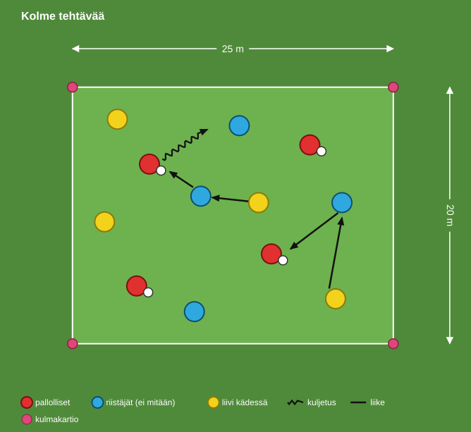

# Kolme tehtävää

## Tavoite
Jokaisella pelaajalla on koko ajan yksi kolmesta tehtävästä, ja tehtävä vaihtuu
kesken pelin. Pelaaja oppii pitämään katseen ylhäällä ja seuraamaan sekä omaa
uhkaansa että omaa kohdettaan: pallollinen suojaa palloa riistäjiltä, riistäjä
prässää pallollisia ja väistelee samalla hippaajia, ja hippaaja etsii vapaan
riistäjän.

## Järjestelyt
- Alue 25 × 20 m, kulmakartiot.
- 12 pelaajaa kolmessa yhtä suuressa ryhmässä:
  - **pallolliset** (4): jokaisella oma pallo
  - **hippaajat** (4): liivi kädessä
  - **riistäjät** (4): ei palloa eikä liiviä
- Isommalle ryhmälle tehdään toinen alue viereen.

## Kulku
1. Peli alkaa, kun kaikki ovat alueella. Pallolliset kuljettavat palloa ja
   suojaavat sitä, riistäjät yrittävät riistää palloja ja hippaajat jahtaavat
   riistäjiä.
2. **Riisto:** kun riistäjä voittaa pallon, siitä tulee pallollinen. Pallon
   menettänyt pelaaja on nyt riistäjä ja yrittää riistää pallon joltakin toiselta
   pallolliselta, ei siltä, joka sen juuri vei.
3. **Hippa:** hippaaja saa hipata vain riistäjää. Hipasta hippaaja antaa liivin
   hipatulle, jolloin hipatusta tulee hippaaja ja entisestä hippaajasta riistäjä.
4. Ryhmien koko pysyy koko ajan samana, mutta jokainen kiertää kaikkia tehtäviä.
5. Pelataan 3–4 jaksoa, 2 minuuttia kerrallaan, ja jaksojen välissä tauko.

## Valmennuspisteet
- **Pallollinen:** katse ylös kuljettaessa, tunnista lähin riistäjä ajoissa.
  Pidä vartalo riistäjän ja pallon välissä ja pallo kauemmalla jalalla. Vie
  pallo pois paineesta tilaan, jossa ei ole riistäjiä.
- **Riistäjä:** valitse kohde, jonka pallo karkaa tai joka ei näe sinua, ja
  prässää nopeasti. Hidasta viimeisillä askelilla, ettei pallollinen ohita.
  Tarkista samalla olan yli, missä hippaajat ovat.
- **Hippaaja:** katso koko aluetta ja valitse riistäjä, joka keskittyy palloon
  eikä näe sinua.
- **Tehtävän vaihtuessa:** uusi tehtävä alkaa heti. Pallon menettänyt kääntyy
  saman tien riistämään, ja hipattu ottaa liivin ja lähtee jahtiin.

## Onnistumisen mittari
Pelaajat vaihtavat tehtävää ilman viivettä, pallolliset pitävät pallon
pidempään, ja riistäjät katsovat olan yli ennen kuin lähtevät prässäämään.
