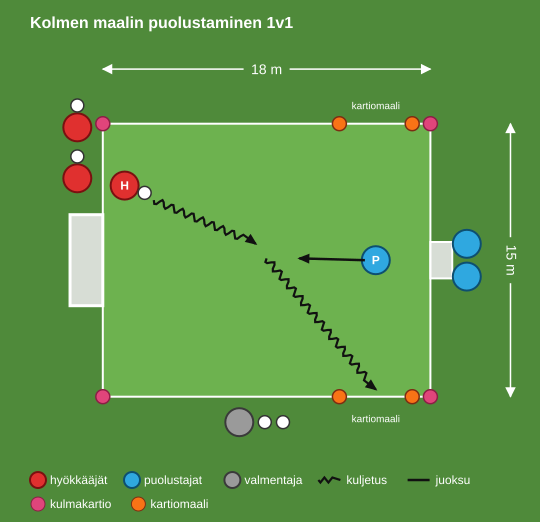

# Kolmen maalin puolustaminen 1v1

## Tavoite
Puolustaja oppii lähtemään nopeasti painostamaan, jarruttamaan ennen
kaksinkamppailua ja asettumaan niin, että yksi kolmesta maalista jää varjoon,
sekä ohjaamaan hyökkääjän sitä kohti. Riiston jälkeen puolustaja hyökkää
nopeasti isoon maaliin. Hyökkääjä oppii valitsemaan maalin, jonka puolustaja
jättää auki, ja painostamaan heti takaisin, jos pallo menetetään.

## Järjestelyt
- Alue 18 × 15 m (päädystä päätyyn 18 m, leveys 15 m).
- Toisessa päädyssä on iso maali. Vastakkaisen päädyn keskellä on pikkumaali,
  ja kummallakin sivurajalla sen lähellä on noin 4 m leveä kartiomaali.
- Hyökkääjät jonottavat palloineen ison maalin vieressä ja puolustajat
  pikkumaalin takana. Valmentaja seisoo sivurajalla palloineen.
- 6–8 pelaajaa per suorituspaikka. Kolme suorituspaikkaa mahtuu rinnakkain
  8v8-kentälle (60 × 40 m): kentän pituus jaetaan kolmeen 20 metrin kaistaan,
  ja kunkin kaistan leveydestä jää tilaa jonoille ja valmentajalle.
- Välineet: iso maali, pikkumaali, 8 kartiota (4 kulmiin, 4 kartiomaaleihin),
  liivit, palloja.

## Kulku
1. Hyökkääjä lähtee omasta aloitteestaan pallon kanssa ison maalin edestä.
   Puolustaja lähtee samalla hetkellä pikkumaalin edestä ja spurttaa
   painostamaan.
2. Hyökkääjä yrittää tehdä maalin pikkumaaliin tai kuljettaa pallon
   jommankumman sivurajan kartiomaalin läpi.
3. Puolustaja yrittää estää maalin ja voittaa pallon. Riistosta hän saa
   pisteen.
4. Riiston jälkeen puolustaja hyökkää isoon maaliin, ja hyökkääjä painostaa
   heti takaisin. Maalista isoon maaliin puolustaja saa toisen pisteen.
5. Tilanne päättyy maaliin tai siihen, että pallo menee alueen ulos.
   Pelaajat palaavat oman jononsa perälle.
6. Hyökkääjät ja puolustajat vaihtavat jonoja intervallina, esim. 3 minuutin
   välein.

## Valmennuspisteet
Valitaan 1–2 kerrallaan.
- **1P:** spurtti painostamaan heti, kun hyökkääjä lähtee liikkeelle.
- **1P:** jarrutus ja matala asento ennen kaksinkamppailua, ettei hyökkääjä
  pääse ohi yhdellä liikkeellä.
- **1P:** asetu niin, että yksi maaleista jää varjoon, ja ohjaa hyökkääjä sitä
  kohti tai sivurajalle.
- **1P:** riisto vasta, kun hyökkääjä tekee virheen, esimerkiksi liian pitkän
  kosketuksen.
- **1P riiston jälkeen:** ensimmäinen kosketus pois painostajasta ja nopea
  hyökkäys isoon maaliin.
- **1H:** katse ylös ja maalin valinta puolustajan sijainnin mukaan.
- **1H pallon menetettyään:** heti painostamaan pallon ja ison maalin väliin.

## Onnistumisen mittari
Puolustajat pysäyttävät hyökkääjän vauhdin ennen maaleja ja pakottavat hänet
yhä useammin varjossa olevan maalin suuntaan tai sivurajalle. Riistojen
jälkeen hyökkäys isoon maaliin lähtee ilman viivettä. Pisteitä lasketaan
kierroksittain.
