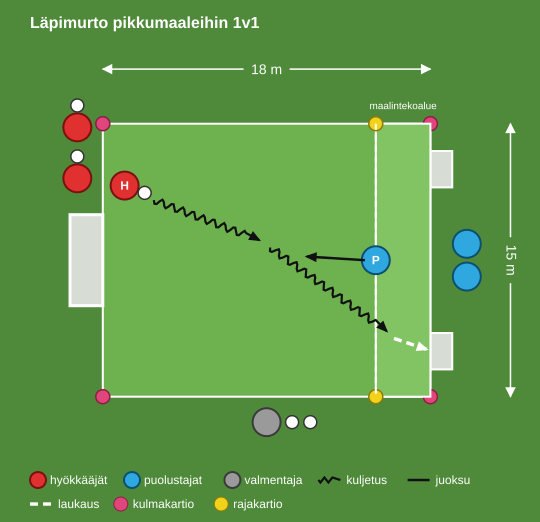

# Läpimurto pikkumaaleihin 1v1

## Tavoite
Hyökkääjä oppii hyökkäämään puolustajaa kohti kovassa vauhdissa, havainnoimaan,
kumpi pikkumaaleista jää auki, ja murtautumaan sitä kohti. Puolustaja oppii
lähtemään nopeasti vastaan, jarruttamaan ennen kaksinkamppailua ja ohjaamaan
hyökkääjän toiseen pikkumaaliin tai sivurajaa kohti. Pallon vaihtaessa
omistajaa molemmat harjoittelevat siirtymää.

## Järjestelyt
- Alue 18 × 15 m (päädystä päätyyn 18 m, leveys 15 m).
- Toisessa päädyssä on iso maali. Vastakkaisessa päädyssä on kaksi pikkumaalia
  lähellä kulmia. Noin 3 m niiden edessä on kartioilla merkitty poikittainen
  viiva, ja viivan ja pikkumaalien väliin jää maalintekoalue.
- Hyökkääjät jonottavat palloineen ison maalin vieressä ja puolustajat
  pikkumaalien takana. Valmentaja seisoo sivurajalla palloineen.
- 6–8 pelaajaa per suorituspaikka. Kolme suorituspaikkaa mahtuu rinnakkain
  8v8-kentälle (60 × 40 m): kentän pituus jaetaan kolmeen 20 metrin kaistaan,
  ja kunkin kaistan leveydestä jää tilaa jonoille ja valmentajalle.
- Välineet: iso maali, 2 pikkumaalia, 6 kartiota (4 kulmiin, 2 viivalle),
  liivit, palloja.

## Kulku
1. Hyökkääjä lähtee omasta aloitteestaan pallon kanssa ison maalin edestä ja
   kuljettaa kovassa vauhdissa kohti pikkumaaleja.
2. Puolustaja lähtee samalla hetkellä viivalta vastaan ja painostaa.
3. Hyökkääjä yrittää ohittaa puolustajan ja tehdä maalin jompaankumpaan
   pikkumaaliin maalintekoalueelta.
4. Jos puolustaja voittaa pallon, hän hyökkää isoon maaliin, ja hyökkääjä
   siirtyy heti puolustamaan.
5. Tilanne päättyy maaliin tai siihen, että pallo menee alueen ulos. Jos pallo
   menee ulos, valmentaja syöttää uuden pallon seuraavalle hyökkääjälle.
6. Pelaajat palaavat oman jononsa perälle. Hyökkääjät ja puolustajat vaihtavat
   jonoja intervallina, esim. 3 minuutin välein.

## Valmennuspisteet
Valitaan 1–2 kerrallaan.
- **1H:** ensimmäinen kosketus heti eteen ja vauhti päälle.
- **1H:** pidemmät kosketukset vapaassa tilassa, lyhyemmät puolustajan lähellä.
- **1H:** katse ylös – hyökkää siihen pikkumaaliin, jonka puolustaja jättää auki.
- **1H:** harhautus ja kiihdytys heti sen jälkeen.
- **1P:** nopea lähtö vastaan, jotta hyökkääjän vauhti katkeaa.
- **1P:** jarrutus ja matala asento ennen kaksinkamppailua, ettei hyökkääjä
  pääse ohi yhdellä liikkeellä.
- **1P:** asetu niin, että toinen pikkumaali jää varjoon, ja ohjaa hyökkääjä
  kohti toista maalia tai sivurajaa.
- **Pallon vaihtaessa omistajaa:** riistäjä hyökkää heti isoon maaliin;
  pallon menettänyt siirtyy heti puolustamaan.

## Onnistumisen mittari
Hyökkääjät tulevat puolustajaa kohti vauhdilla eivätkä pysähdy pallon kanssa,
ja maalit syntyvät auki jääneeseen pikkumaaliin. Puolustajat pysäyttävät
hyökkääjän vauhdin yhä useammin ennen viivaa, ja pallon vaihtaessa omistajaa
kumpikin reagoi ilman viivettä.
