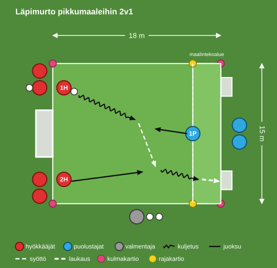

# Läpimurto pikkumaaleihin 2v1

## Tavoite
Hyökkääjäpari oppii käyttämään 2v1-ylivoiman nopeasti, ennen kuin puolustaja
ehtii asettua: pallollinen kuljettaa puolustajaa kohti ja syöttää, kun tämä
sitoutuu, ja pallottomana oleva pysyy leveällä tai syvällä. Pallon
menetettyään pari painostaa heti takaisin. Puolustaja oppii spurttaamaan
painostamaan, peittämään syöttölinjan ja hyökkäämään nopeasti isoon maaliin
pallon voitettuaan.

## Järjestelyt
- Alue 18 × 15 m (päädystä päätyyn 18 m, leveys 15 m).
- Toisessa päädyssä on iso maali. Vastakkaisessa päädyssä on kaksi pikkumaalia
  lähellä kulmia. Noin 3 m niiden edessä on kartioilla merkitty poikittainen
  viiva, ja viivan ja pikkumaalien väliin jää maalintekoalue.
- Hyökkääjät jonottavat palloineen kahdessa jonossa ison maalin molemmin
  puolin ja puolustajat pikkumaalien takana. Valmentaja seisoo sivurajalla
  palloineen.
- 6–9 pelaajaa per suorituspaikka. Kolme suorituspaikkaa mahtuu rinnakkain
  8v8-kentälle (60 × 40 m): kentän pituus jaetaan kolmeen 20 metrin kaistaan,
  ja kunkin kaistan leveydestä jää tilaa jonoille ja valmentajalle.
- Kenttä on sama kuin harjoitteessa Läpimurto pikkumaaleihin 1v1, joten
  harjoitteista saa etenevän sarjan: ensin 1v1, sitten 2v1.
- Välineet: iso maali, 2 pikkumaalia, 6 kartiota (4 kulmiin, 2 viivalle),
  liivit, palloja.

## Kulku
1. Hyökkääjäpari lähtee omasta aloitteestaan, yksi kummastakin jonosta, ja
   toisella heistä on pallo.
2. Puolustaja lähtee samalla hetkellä viivalta ja spurttaa painostamaan.
3. Hyökkääjät yrittävät tehdä maalin jompaankumpaan pikkumaaliin
   maalintekoalueelta 2v1-ylivoimaa hyödyntäen.
4. Jos puolustaja voittaa pallon, hän hyökkää isoon maaliin. Hyökkääjät
   painostavat heti takaisin.
5. Tilanne päättyy maaliin tai siihen, että pallo menee alueen ulos. Jos pallo
   menee ulos, valmentaja syöttää uuden pallon seuraavalle parille.
6. Pelaajat palaavat oman jononsa perälle. Hyökkääjät ja puolustajat vaihtavat
   jonoja intervallina, esim. 3 minuutin välein.

## Valmennuspisteet
Valitaan 1–2 kerrallaan.
- **1H:** aktiivinen ensimmäinen kosketus eteenpäin, jotta ylivoima käytetään
  ennen kuin puolustaja ehtii asettua.
- **1H:** kuljeta puolustajaa kohti, ja kun hän sitoutuu, syötä vapaalle.
- **2H:** pysy leveällä tai syvällä, jotta puolustaja ei voi peittää molempia.
- **1H ja 2H pallonmenetyksen jälkeen:** heti painostamaan ja pallo takaisin
  viidessä sekunnissa, ettei puolustaja pääse isolle maalille.
- **1P:** spurtti painostamaan ja hidastaminen ennen hyökkääjiä, jotta he
  joutuvat tekemään päätöksen.
- **1P:** asetu hyökkääjien väliin niin, että syöttölinja on varjossa.
- **1P:** ohjaa pallollinen sivulle ja pois maalien edestä.
- **1P pallon voiton jälkeen:** nopea hyökkäys isoon maaliin.

## Onnistumisen mittari
Parit tekevät ratkaisunsa ennen kuin puolustaja on ehtinyt asettua, ja maalit
syntyvät syötöistä vapaalle silloin, kun puolustaja sitoutuu palloon. Pallon
menetettyään pari voittaa pallon takaisin yhä useammin ennen kuin puolustaja
pääsee laukaisemaan isoon maaliin.
