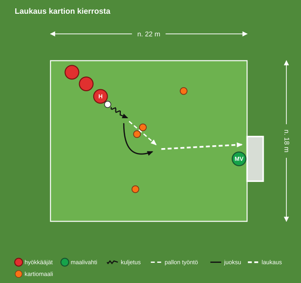

# Laukaus kartion kierrosta

## Tavoite
Pelaaja oppii laukomaan liikkeestä: hän työntää pallon eteen, kiertää kartion
nopeasti, avaa vartalon kohti maalia ja laukoo tarkasti maalin kulmaan
maalivahdin ohi.

## Järjestelyt
- Alue noin 22 × 18 m ison maalin edessä (rangaistusalue ja sen edusta).
- Kartioportti, jonka kartiot ovat noin metrin päässä toisistaan, noin
  12–14 metrin päähän maalista viistosti maalin sivulle.
- Hyökkääjät jonottavat palloineen portin takana viistosti, noin 5–6 metrin
  päässä portista. Maalivahti maalissa.
- 6–8 pelaajaa ja maalivahti. Isommalle ryhmälle tehdään toinen suorituspaikka
  maalin toiselle puolelle.
- Välineet: iso maali, 2 kartiota, palloja jokaiselle.

## Kulku
1. Jonon ensimmäinen lähtee omasta aloitteestaan ja kuljettaa pallon kohti
   kartioporttia.
2. Ennen porttia hän työntää pallon kartioiden välistä kohti maalia ja kiertää
   itse maalin puoleisen kartion.
3. Hän ottaa pallon kiinni ja laukoo maaliin joko suoraan tai yhden
   ohjaavan kosketuksen jälkeen.
4. Laukaisija hakee pallonsa ja palaa jonon perälle. Seuraava lähtee, kun
   edellinen on laukaissut.
5. Suorituspuolta vaihdetaan intervalleittain, jotta laukaukset tulevat
   kummallakin jalalla.

## Valmennuspisteet
Valitaan 1–2 kerrallaan.
- Työnnä pallo niin pitkälle, että ehdit kartion ympäri pallon luo ilman, että joudut pysähtymään.
- Kierrä kartio tiukasti ja kiihdytä kohti palloa.
- Vilkaise maalivahdin sijainti ennen laukausta.
- Tukijalka pallon viereen ja vartalo pallon päälle, jotta laukaus pysyy matalana.
- Osu palloon nilkka lukittuna rinnalla tai sisäsyrjällä ja tähtää maalin kulmaan.
- Seuraa laukausta maalille mahdollisen torjunnan varalta.

## Onnistumisen mittari
Pelaajat kiertävät kartion pysähtymättä ja laukovat yhä useammin matalia ja
tarkkoja laukauksia maalin kulmiin, myös heikommalla jalalla.
