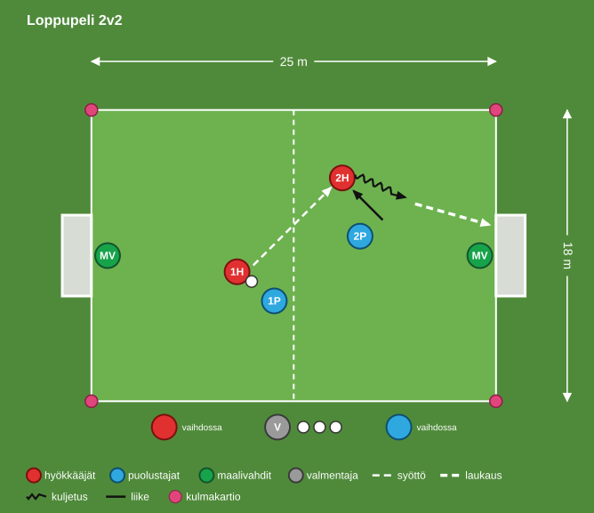

# Loppupeli 2v2

## Tavoite
Harjoituksen teema siirretään oikeaan peliin: pelaajat vapautuvat varjosta,
orientoituvat ennen vastaanottoa ja vievät ensimmäisellä kosketuksella pallon
eteenpäin pois paineesta.

## Järjestelyt
- Kenttä 25 × 18 m, isot maalit (5 m) päädyissä.
- 8 pelaajaa: kummallakin joukkueella maalivahti, kaksi kenttäpelaajaa ja
  yksi vaihtopelaaja (MV + 2v2).
- Valmentaja pallovaraston kanssa sivurajalla.

## Kulku
1. Pelataan normaalia peliä 2v2 maalivahdein.
2. Maalin jälkeen peli alkaa maalivahdilta.
3. Sivurajan ylityksen jälkeen peli jatkuu sivurajalta syöttämällä tai
   kuljettamalla sisään.
4. Intervallit, esim. 4 × 3 min. Pelaajat vaihdetaan intervallien välissä:
   vaihtopelaaja tulee peliin, joten jokainen on vuorollaan vaihdossa ja maalissa.

## Valmennuspisteet
- **1H:** katso ennen syöttöä, kuka on vapautunut varjosta, ja syötä etummaiselle jalalle.
- **2H:** liiku ulos puolustajan varjosta ennen syöttöä ja ota ensimmäinen
  kosketus eteenpäin pois paineesta.
- **1P, 2P:** pidä syöttölinja varjossa ja painosta, kun vastaanottaja on selkä menosuuntaan.
- Valmentaja pysäyttää pelin harvoin ja kehuu ääneen onnistuneita teeman mukaisia ratkaisuja.

## Onnistumisen mittari
Pelaajat kääntyvät vastaanotossa eteenpäin useammin kuin harjoituksen alussa,
ja maalit syntyvät pelaajista, jotka ovat vapautuneet varjosta.
