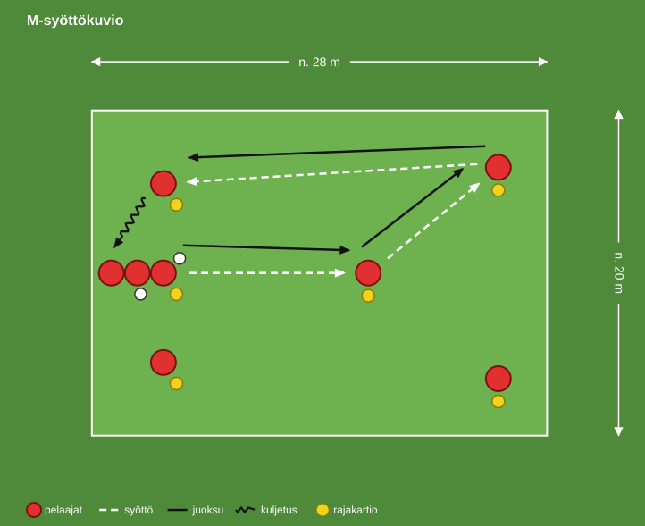

# M-syöttökuvio

## Tavoite
Pelaaja oppii syöttämään tarkasti maata pitkin ja ottamaan syötön vastaan
avoimella vartalolla niin, että pallo jatkaa heti eteenpäin sivulle. Kuviossa
jokainen kiertää kaikki paikat, joten jokainen syöttää ja vastaanottaa
sekä lyhyitä että pitkiä syöttöjä.

## Järjestelyt
- Alue noin 28 × 20 m. Kartiot M-muotoon: lähtökartio, siitä noin
  14 m päähän keskikartio ja keskikartiosta noin 10 m päähän kaksi sakaraa
  vinosti eteen vasemmalle ja oikealle. Lähtöpäätyyn, noin 5 m
  lähtökartion kummallekin sivulle, paluukartio.
- 7–8 pelaajaa: yksi keskikartiolla, yksi kummallakin sakaralla, yksi
  kummallakin paluukartiolla ja muut jonossa lähtökartiolla. Isommalle
  ryhmälle tehdään toinen suorituspaikka viereen.
- Välineet: 6 kartiota ja 2 palloa.

## Kulku
1. Jonon ensimmäinen syöttää keskikartiolla olevalle ja seuraa syöttöään
   keskikartiolle.
2. Keskikartiolla oleva ottaa pallon vastaan avoimella vartalolla, syöttää
   toiselle sakaralle ja seuraa syöttöään sille sakaralle.
3. Sakaralla oleva ottaa pallon vastaan, syöttää sen pitkänä maasyöttönä
   saman puolen paluukartiolla olevalle ja seuraa syöttöään sille
   paluukartiolle.
4. Paluukartiolla oleva ottaa pallon vastaan ja kuljettaa sen jonon perään.
5. Seuraavalla kierroksella keskikartiolta syötetään toiselle sakaralle.
   Sakarat vuorottelevat koko ajan.
6. Toinen pallo on jonossa. Seuraava syöttö lähtee, kun keskikartiolle
   tullut pelaaja on valmiina ottamaan vastaan.

## Valmennuspisteet
Valitaan 1–2 kerrallaan.
- **Syöttäjä:** maasyöttö vastaanottajan kauemmalle jalalle, sopivalla
  vauhdilla.
- **Keskikartio:** katso olan yli ennen syöttöä, minne pallo jatkaa.
- **Keskikartio:** vartalo auki sakaraa kohti ja vastaanotto kauemmalla
  jalalla, jotta pallo kääntyy eteen yhdellä kosketuksella.
- **Sakara:** liiku hieman irti ja tule palloa vastaan ennen vastaanottoa.
- **Sakara:** ensimmäinen kosketus paluusyötön suuntaan ja pitkä syöttö
  maata pitkin paluupelaajalle.
- **Paluupelaaja:** avaa vartalo sakaraa kohti ja ota vastaanotto jonon
  suuntaan.
- **Kaikki:** puhu ja näytä, mihin haluat pallon.

## Onnistumisen mittari
Pallo kulkee keskikartiolta sakaralle kahdella kosketuksella ilman
korjaavaa kosketusta, ja kierros pysyy käynnissä ilman pysähdyksiä
molempiin suuntiin.
