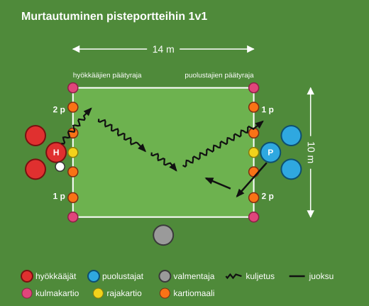

# Murtautuminen pisteportteihin 1v1

## Tavoite
Hyökkääjä oppii ohittamaan puolustajan kuljettaen harhautuksen sekä suunnan ja
tempon muutosten avulla ja valitsemaan, kumpaan porttiin hyökkää.
Puolustaja oppii lähtemään nopeasti vastaan, jarruttamaan ennen
kaksinkamppailua ja ohjaamaan hyökkääjän kohti vähemmän arvokasta porttia
tai sivurajaa.

## Järjestelyt
- Suorakaiteen muotoinen alue 14 × 10 m (päätyrajalta päätyrajalle 14 m,
  leveys 10 m). Kummallakin päätyrajalla on kaksi noin 2 m leveää
  porttimaalia kartioilla merkittynä ja porttien välissä aloituskartio.
- Kummankin päädyn toinen portti on 1 pisteen ja toinen 2 pisteen arvoinen.
  Portit ovat päädyissä ristikkäin: hyökkäyssuuntaan katsottuna 2 pisteen
  portti on aina hyökkääjän oikealla puolella, ja toisessa päädyssä se on
  alueen vastakkaisella sivulla.
- Hyökkääjät jonottavat pallojen kanssa toisen päätyrajan takana ja
  puolustajat vastakkaisen päätyrajan takana. Valmentaja seisoo sivurajalla.
- 6–8 pelaajaa per suorituspaikka. Kolme suorituspaikkaa mahtuu rinnakkain
  8v8-kentälle (60 × 40 m): kentän pituus jaetaan kolmeen 20 metrin kaistaan ja
  alue asetetaan kaistalle pitkittäin, jolloin päätyihin jää tilaa jonoille.
- Välineet: 14 kartiota (4 kulmiin, kummallekin päätyrajalle 4 kahdeksi portiksi
  ja 1 aloituskartioksi), liivit, pallo jokaiselle hyökkääjälle.

## Kulku
1. Hyökkääjä asettuu pallon kanssa oman päätyrajansa aloituskartiolle ja
   puolustaja omalleen, vastakkain.
2. Hyökkääjä lähtee omasta aloitteestaan ja kuljettaa ensin oman päätynsä
   jommankumman portin läpi alueelle. Lähtöportin valinnalla ei ole
   merkitystä pisteisiin. Puolustaja lähtee samaan aikaan ja juoksee oman
   päätynsä vastakkaisen puolen portin läpi: jos hyökkääjä valitsee vasemman
   portin, puolustaja tulee oikean puolen portista ja päinvastoin.
3. Pelialueelle päästyään hyökkääjä yrittää tehdä maalin kuljettamalla pallon
   jommankumman puolustajan päätyrajalla olevan portin läpi. Maali on 1 tai
   2 pisteen arvoinen portin mukaan.
4. Jos puolustaja voittaa pallon, roolit vaihtuvat heti: puolustaja hyökkää
   vastakkaisen päädyn portteihin ja entinen hyökkääjä puolustaa.
5. Tilanne päättyy maaliin tai siihen, että pallo menee alueen ulos.
6. Pelaajat siirtyvät vastakkaisen jonon perälle, ja seuraava pari aloittaa.

## Valmennuspisteet
Valitaan 1–2 kerrallaan.
- **1H:** hyökkää puolustajaa kohti, jotta hänen on pakko pysähtyä ja valita suunta.
- **1H:** vartaloharhautus tai kuljetusharhautus ja räjähtävä kiihdytys sen jälkeen.
- **1H:** houkuttele puolustaja toisen portin eteen ja hyökkää toiseen.
- **1H:** pallo lähellä jalkaa kaksinkamppailussa, pidempi kosketus vasta ohituksen jälkeen.
- **1P:** nopea lähtö vastaan, jotta hyökkääjällä on vähemmän tilaa.
- **1P:** jarrutus ja matala asento ennen kaksinkamppailua.
- **1P:** asetu niin, että 2 pisteen portti on suljettu, ja ohjaa hyökkääjä
  kohti 1 pisteen porttia tai sivurajaa.
- **Pallon vaihtaessa omistajaa:** riistäjä kääntyy heti kohti vastakkaista
  päätyä; pallon menettänyt siirtyy heti puolustamaan.

## Onnistumisen mittari
Hyökkääjät hyökkäävät puolustajaa kohti, harhauttavat ja ohittavat vauhdilla
eivätkä pysähdy pallon kanssa. Puolustajat sulkevat 2 pisteen portin yhä
useammin ja pakottavat hyökkääjän 1 pisteen porttiin tai sivulle.
Pisteitä lasketaan kierroksittain.
