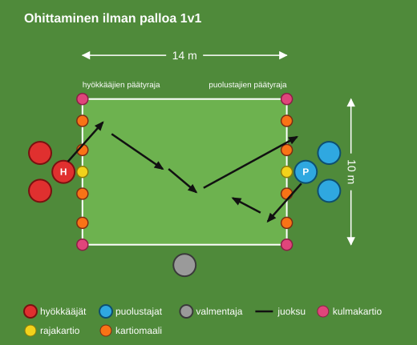

# Ohittaminen ilman palloa 1v1

## Tavoite
Hyökkääjä opettelee vartaloharhautuksen sekä suunnan ja tempon muutokset ilman
palloa ennen kuin samat liikkeet tehdään pallon kanssa. Puolustaja oppii
lähtemään nopeasti vastaan, jarruttamaan ennen kohtaamista ja ohjaamaan
hyökkääjän sivurajaa kohti. Kosketuksesta vaihtuvat roolit opettavat
reagoimaan nopeasti, kun tilanne kääntyy.

## Järjestelyt
- Suorakaiteen muotoinen alue 14 × 10 m (päätyrajalta päätyrajalle 14 m,
  leveys 10 m). Kummallakin päätyrajalla on kaksi noin 2 m leveää
  porttimaalia kartioilla merkittynä ja porttien välissä aloituskartio.
  Ei palloja.
- Hyökkääjät jonottavat toisen päätyrajan takana ja puolustajat vastakkaisen
  päätyrajan takana. Valmentaja seisoo sivurajalla.
- 6–8 pelaajaa per suorituspaikka. Kolme suorituspaikkaa mahtuu rinnakkain
  8v8-kentälle (60 × 40 m): kentän pituus jaetaan kolmeen 20 metrin kaistaan ja
  alue asetetaan kaistalle pitkittäin, jolloin päätyihin jää tilaa jonoille.
  Isommalla ryhmällä kaistalle mahtuu kaksi aluetta vierekkäin.
- Välineet: 14 kartiota (4 kulmiin, kummallekin päätyrajalle 4 kahdeksi portiksi
  ja 1 aloituskartioksi), liivit.

## Kulku
1. Hyökkääjä ja puolustaja asettuvat oman päätyrajansa aloituskartiolle,
   vastakkain.
2. Hyökkääjä lähtee omasta aloitteestaan ja juoksee ensin oman päätynsä
   jommankumman portin läpi alueelle. Puolustaja lähtee samaan aikaan ja
   juoksee oman päätynsä vastakkaisen puolen portin läpi: jos hyökkääjä
   valitsee vasemman portin, puolustaja tulee oikean puolen portista ja
   päinvastoin.
3. Hyökkääjä yrittää juosta jommankumman puolustajan päätyrajalla olevan
   portin läpi ilman, että puolustaja koskettaa häntä. Puolustaja lähtee
   vastaan ja yrittää koskettaa hyökkääjää kädellä ennen kuin tämä pääsee
   portin läpi.
4. Kosketuksessa roolit vaihtuvat heti: koskettanut pelaaja on nyt hyökkääjä
   ja yrittää juosta vastakkaisen päädyn portin läpi, ja kosketettu pelaaja
   puolustaa. Roolit vaihtuvat jokaisessa kosketuksessa.
5. Tilanne päättyy, kun hyökkääjä juoksee portin läpi. Sivurajan yli ajautuva
   hyökkääjä menettää tilanteen.
6. Pelaajat siirtyvät vastakkaisen jonon perälle, ja seuraava pari aloittaa.

## Valmennuspisteet
Valitaan 1–2 kerrallaan.
- **1H:** vartaloharhautus: olkapäät ja ensimmäinen askel yhteen suuntaan, lähtö toiseen.
- **1H:** suunnanmuutos: houkuttele puolustaja yhdelle puolelle ja ohita toiselta.
- **1H:** tempon muutos: hidasta ennen harhautusta ja kiihdytä räjähtävästi heti sen jälkeen.
- **1H:** hyökkää puolustajaa kohti, jotta hänen on pakko pysähtyä ja valita suunta.
- **1H:** valitse portti vasta, kun puolustaja on sitoutunut toiselle puolelle.
- **1P:** nopea lähtö vastaan, jotta hyökkääjällä on vähemmän tilaa.
- **1P:** jarrutus ja matala asento ennen kohtaamista, painopiste päkiöillä.
- **1P:** katse hyökkääjän lantioon, ei olkapäihin, joilla hän harhauttaa.
- **1P:** ohjaa hyökkääjä sivurajaa kohti.
- **Roolin vaihtuessa:** koskettanut kääntyy heti kohti vastakkaista päätyä
  ja kiihdyttää; kosketettu siirtyy heti puolustamaan.

## Onnistumisen mittari
Hyökkääjät tekevät harhautuksen ennen kohtaamista ja kiihdyttävät sen jälkeen
eivätkä juokse suoraan puolustajan ohi. Puolustajat pysähtyvät hallitusti
ennen kohtaamista eivätkä lähde harhautuksen mukaan, ja yhä useampi hyökkääjä
ohjautuu sivurajalle. Kosketuksen jälkeen kumpikin reagoi uuteen rooliinsa
viipymättä. Porttien läpi juoksuja lasketaan kierroksittain.
