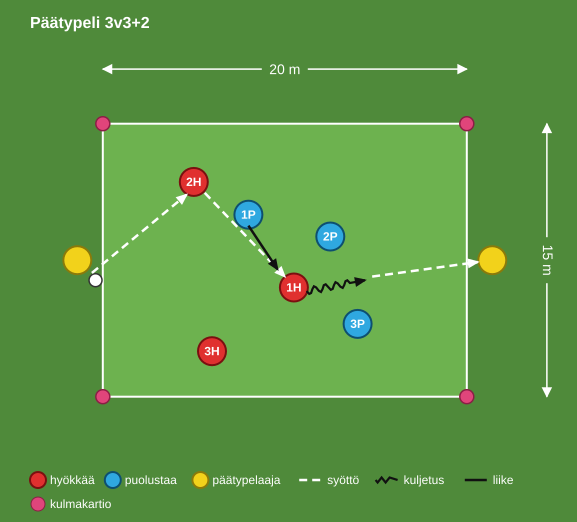

# Päätypeli 3v3+2

## Tavoite
Pallollinen joukkue oppii liikkumaan pelattavaksi ja valitsemaan, eteneekö se
syötöllä vai kuljettamalla, kun sillä on päätypelaajien ansiosta kahden pelaajan
ylivoima. Tavoitteena on edetä maata pitkin mahdollisimman nopeasti päädystä
päätyyn. Puolustava joukkue oppii ajoittamaan painostuksen ja sulkemaan
syöttölinjat keskelle.

## Järjestelyt
- Alue 20 × 15 m (päädystä päätyyn 20 m). Kulmat merkitään kartioilla.
- Kaksi kolmen pelaajan joukkuetta alueen sisällä ja yksi päätypelaaja
  kummassakin päädyssä. Päätypelaajat pelaavat aina pallollisen joukkueen kanssa.
- 8 pelaajaa, ei vaihtopelaajia. Isommalle ryhmälle tehdään toinen alue
  viereen.
- Välineet: 4 kartiota, liivit kahdelle joukkueelle ja päätypelaajille, palloja
  päätyjen takana.

## Kulku
1. Peli alkaa päätypelaajalta, joka syöttää toiselle joukkueelle.
2. Pallollinen joukkue yrittää pelata pallon maata pitkin vastakkaisen päädyn
   päätypelaajalle. Onnistunut läpipeli on piste.
3. Pisteen jälkeen päätypelaaja syöttää pallon takaisin samalle joukkueelle, ja
   joukkue hyökkää kohti vastakkaista päätyä.
4. Päätypelaajat saavat koskea palloa enintään kaksi kertaa eivätkä saa syöttää
   suoraan toisilleen.
5. Kun puolustava joukkue riistää pallon, joukkueiden roolit vaihtuvat heti:
   riistänyt joukkue hyökkää ja päätypelaajat pelaavat sen kanssa.
6. Jos pallo menee ulos, peli jatkuu päätypelaajalta.
7. Intervallit, esim. 4 × 3 min. Intervallien välissä päätypelaajat vaihtavat
   rooleja kenttäpelaajien kanssa, niin että jokainen pelaa vuorollaan
   päädyssä.

## Valmennuspisteet
Valitaan 1–2 kerrallaan.
- **1H:** havainnoi ennen ensimmäistä kosketusta. Jos edessä on tilaa, etene
  kuljettamalla. Jos ei ole, syötä.
- **2H:** liiku pelattavaksi pois puolustajan varjosta, sopivaan kulmaan ja
  etäisyyteen pallollisesta.
- **2H:** jos etenemismahdollisuutta ei ole, pelaa pallo tuelle ja liiku
  uudestaan tukemaan pallollista.
- **3H:** anna syvyyttä tai leveyttä ja liiku heti syötön jälkeen.
- **1P:** lähde painostamaan, kun pallo on matkalla, ja ohjaa pallollinen pois
  keskeltä.
- **2P:** sulje syöttölinja keskelle ja ole valmiina ottamaan seuraava pelaaja.

## Onnistumisen mittari
Pallollinen joukkue saa pallon päädystä päätyyn yhä useammin maata pitkin, ja
puolustava joukkue riistää pallon useammin oikea-aikaisella painostuksella kuin
syöksymällä. Läpipelejä lasketaan intervallin aikana.
