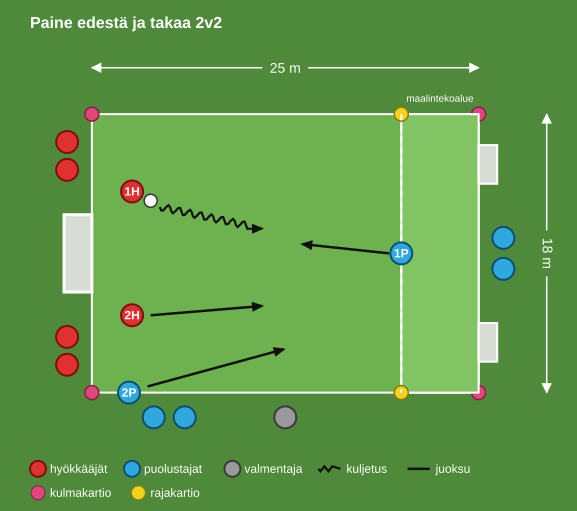

# Paine edestä ja takaa 2v2

## Tavoite
Puolustajat oppivat puolustamaan parina, kun toinen tulee edestä ja toinen
takaa. Edestä painostava lähtee nopeasti vastaan ja hidastaa hyökkäystä, jotta
takaa tuleva ehtii täydellä spurtilla pallon ja maalin väliin. Parin on
sovittava puheella, kumpi painostaa pallollista ja kumpi ottaa vapaan.
Hyökkääjät oppivat hyödyntämään hetken, jolloin heillä on ylivoima edessä
olevaa puolustajaa vastaan.

## Järjestelyt
- Alue noin 25 × 18 m (päädystä päätyyn 25 m, leveys 18 m).
- Toisessa päädyssä on iso maali. Vastakkaisessa päädyssä on kaksi
  pikkumaalia lähellä kulmia, ja noin 5 m niiden edessä on kartioilla
  merkitty viiva. Viivan ja pikkumaalien väliin jää maalintekoalue.
- Hyökkääjät jonottavat palloineen ison maalin molemmin puolin. Puolustajia
  on kahdessa jonossa: toinen pikkumaalien takana ja toinen ison maalin
  vieressä sivurajalla. Valmentaja seisoo sivurajalla palloineen.
- 8–12 pelaajaa per suorituspaikka. Kolme suorituspaikkaa mahtuu rinnakkain
  8v8-kentälle (60 × 40 m), kun alue asetetaan 20 metrin kaistalle
  pitkittäin ja päätyihin jätetään tilaa jonoille.
- Välineet: iso maali, 2 pikkumaalia, 6 kartiota (4 kulmiin, 2 viivalle),
  liivit, palloja.

## Kulku
1. Kaksi hyökkääjää lähtee omasta aloitteestaan pallon kanssa ison maalin
   puolelta kohti pikkumaaleja.
2. Samalla hetkellä edestä painostava puolustaja lähtee viivalta vastaan ja
   takaa tuleva puolustaja ison maalin vierestä hyökkääjien perään.
3. Hyökkääjät yrittävät tehdä maalin jompaankumpaan pikkumaaliin
   maalintekoalueelta ennen kuin takaa tuleva puolustaja ehtii mukaan.
4. Jos puolustajat voittavat pallon, he hyökkäävät isoon maaliin, ja
   hyökkääjät painostavat heti takaisin.
5. Tilanne päättyy maaliin tai siihen, että pallo menee alueen ulos.
   Pelaajat palaavat jonojen perälle.
6. Pelaajat vaihtavat jonoja intervallina, esim. 3 minuutin välein, niin että
   jokainen pelaa vuorollaan hyökkääjänä, edestä painostavana ja takaa
   tulevana puolustajana.

## Valmennuspisteet
Valitaan 1–2 kerrallaan.
- **Edestä painostava (1P):** nopea lähtö vastaan, sitten jarrutus ja
  hidastaminen – älä mene riistoon yksin, vaan odota apua.
- **Takaa tuleva (2P):** täysi spurtti ja paluu pallon ja maalin väliin.
- **Kommunikointi:** kumpi painostaa pallollista, kumpi ottaa vapaan.
- **Pallon voiton jälkeen:** nopea hyökkäys isoon maaliin.
- **1H ja 2H:** ensimmäinen kosketus eteenpäin ja hyökkäys edessä olevaa
  puolustajaa kohti, ennen kuin takaa tuleva ehtii mukaan; syötä vapaalle,
  kun puolustaja sitoutuu.

## Onnistumisen mittari
Edestä painostava puolustaja hidastaa hyökkäystä niin, että takaa tuleva ehtii
yhä useammin mukaan ennen maalintekoaluetta. Puolustajat puhuvat jokaisessa
tilanteessa siitä, kumpi ottaa pallollisen.
