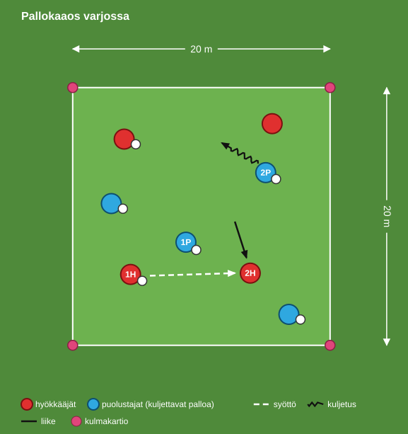

# Pallokaaos varjossa

## Tavoite
Lämmittely, jossa jokainen käsittelee palloa koko ajan. Hyökkääjät
vapautuvat liikkuvista varjoista ja ottavat ensimmäisen kosketuksen
avoimella vartalolla. Puolustajat opettelevat sulkemaan syöttölinjoja
asemoitumalla, ilman riistoa.

## Järjestelyt
- Ruutu 20 × 20 m, kulmakartiot.
- 8 pelaajaa: neljä hyökkääjää (punainen) ja neljä puolustajaa (sininen).
- Jokaisella puolustajalla on oma pallo, hyökkääjillä yksi pallo paria kohti.

## Kulku
1. **Taso 1 – pareittain:** hyökkääjät pelaavat kahtena parina ja syöttävät
   oman parin kanssa. Syötön saa antaa vain, kun syöttölinja on vapaa.
2. Puolustajat kuljettavat omaa palloaan ja yrittävät asettua parien
   syöttölinjoille. Ne eivät riistä.
3. **Taso 2 – joukkueena:** neljällä hyökkääjällä on yhteensä kaksi palloa,
   ja syötön saa antaa kenelle tahansa omasta joukkueesta.
4. Hyökkääjät laskevat onnistuneet syötöt minuutin ajalta. Syöttö, joka osuu
   puolustajaan tai tämän palloon, ei kelpaa.
5. Roolit vaihtuvat 2–3 minuutin välein.

## Valmennuspisteet
- **1H:** katso ennen syöttöä, onko linja vapaa – odota tai kuljeta, kunnes on.
- **2H:** liiku ulos puolustajan varjosta ennen syöttöä, avaa vartalo ja ota
  ensimmäinen kosketus menosuuntaan, molemmilla jaloilla.
- **1P, 2P:** katse ylös kuljettaessa; asetu pallollisen ja vastaanottajan väliin.
- **Taso 2:** vastaanottaja tarkistaa ennen vastaanottoa, kuka on vapaana seuraavaksi.

## Onnistumisen mittari
Onnistuneiden syöttöjen määrä minuutissa kasvaa jaksosta toiseen, ja
vastaanottajat ovat valmiiksi liikkeellä ennen syöttöä.
