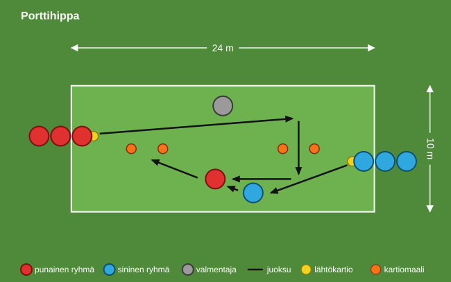

# Porttihippa

## Tavoite
Pelaaja kehittää lähtönopeutta, kiihdytystä ja kääntymistä täydestä
vauhdista. Hippaaja lähtee liikkeelle reagoiden karkuun juoksijan
kääntymiseen, ja karkuun juoksija kiihdyttää heti käännöksen jälkeen
täyteen vauhtiin.

## Järjestelyt
- Kaksi noin 2,5 m leveää porttimaalia asetetaan vaakatasoon samalle
  linjalle noin 10–15 metrin päähän toisistaan. Alue on noin 24 × 10 m.
- Kummankin portin ulkopuolelle asetetaan lähtökartio noin 3 m päähän
  portista ja 1 m sivuun porttien linjasta: punaisten kartio linjan
  yläpuolelle ja sinisten kartio alapuolelle.
- Pelaajat jaetaan kahteen ryhmään liiveillä, esimerkiksi 10 pelaajaa,
  5 + 5. Ryhmät asettuvat jonoon oman lähtökartionsa taakse alueen
  vastakkaisiin päihin. Isommalle ryhmälle tehdään toinen alue viereen.
- Välineet: 6 kartiota, liivit.

## Kulku
1. Punaisen jonon ensimmäinen lähtee omasta aloitteestaan lähtökartiolta
   ja juoksee porttien yläpuolella sinisten porttimaalille. Hän juoksee
   portin läpi, kääntyy ja juoksee karkuun porttien alapuolella takaisin
   kohti omaa porttiaan. Siniset juoksevat päinvastoin: porttien
   alapuolella punaisten portille ja yläpuolella takaisin.
2. Sinisen jonon ensimmäinen lähtee hippaamaan heti, kun karkuun juoksija
   on läpäissyt portin.
3. Karkuun juoksija on turvassa, kun hän ohittaa oman porttinsa.
   Jos hippaaja koskettaa häntä ennen sitä, hippaajan ryhmä saa pisteen.
   Jos karkuun juoksija pääsee turvaan, hänen ryhmänsä saa pisteen.
4. Hippaaja ei pysähdy, vaan juoksee heti suoraan vastustajan
   porttimaalin läpi, kääntyy ja juoksee karkuun oman ryhmänsä
   paluureittiä kohti omaa porttiaan.
   Vastustajan jonon seuraava lähtee hippaamaan, kun hän on läpäissyt portin.
5. Turvaan päässyt tai hipattu pelaaja menee oman jononsa perälle. Peli
   jatkuu ketjuna niin, että roolit vaihtuvat joka juoksulla.
6. Peliä pelataan esimerkiksi 2–3 minuutin jaksoissa, joiden välissä on
   palautus. Eniten pisteitä kerännyt ryhmä voittaa.

## Valmennuspisteet
Valitaan 1–2 kerrallaan.
- Lähde räjähtävästi: matala asento ja lyhyet, nopeat ensiaskeleet.
- Karkuun juoksija: käänny portin takana tiukasti ja matalana ja
  kiihdytä heti täyteen vauhtiin.
- Hippaaja: seuraa karkuun juoksijaa ja lähde heti, kun hän läpäisee portin.
- Hippaaja: kun saat kosketuksen, jatka saman tien kohti vastustajan
  porttia, sillä uusi hippaaja odottaa jo.
- Juokse koko matka täysillä oman porttisi ohi asti.

## Onnistumisen mittari
Pelaajat lähtevät liikkeelle viiveettä, juoksevat koko matkan täydellä
vauhdilla ja kääntyvät portin takana hidastamatta turhaan, ja ketju
jatkuu ilman odottelua.
