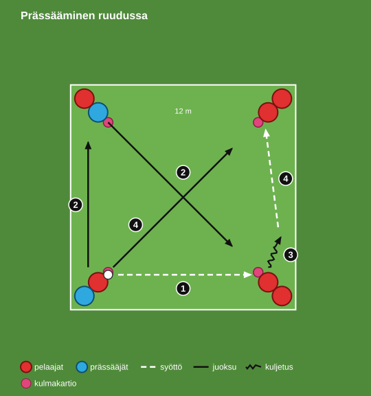

# Prässääminen ruudussa

## Tavoite
Pelaaja oppii prässäyksen tekniikan ilman riistoa: nopea lähestyminen
syötön aikana, jarrutus lyhyin askelin, matala sivuttainen asento ja
vastaanottajan ohjaaminen haluttuun suuntaan. Samalla vastaanottaja harjoittelee
paineen havaitsemista ja ensimmäistä kosketusta pois paineesta.

## Järjestelyt
- 12 × 12 m:n ruutu, kartio jokaisessa kulmassa.
- Jono jokaisessa kulmassa, 2–3 pelaajaa jonossa. Isommalle ryhmälle tehdään
  toinen ruutu viereen.
- Pallo yhden kulman ensimmäisellä pelaajalla, varapalloja kulmien taakse.

## Kulku
1. Pallollinen syöttää maata pitkin vasemmalle tai oikealle viereiseen kulmaan.
2. Kun pallo lähtee, vastaanottajan ristikkäisen kulman ensimmäinen lähtee
   prässäämään vastaanottajaa ruudun poikki.
3. Prässääjä lähestyy nopeasti, jarruttaa ja asettuu noin 1,5 metrin päähän
   vastaanottajasta sivuttaiseen asentoon. Hän ohjaa asennollaan, mutta ei riistä.
4. Vastaanottaja ottaa pallon vastaan ja ohjaa sen ensimmäisellä kosketuksella
   poispäin prässääjästä. Sen jälkeen hän syöttää pallon heti eteenpäin
   vasemmalle tai oikealle viereiseen kulmaan.
5. Uuden vastaanottajan ristikkäisen kulman ensimmäinen reagoi syöttöön ja
   lähtee prässäämään, ja sama toistuu. Pallo kiertää ruudussa koko ajan.
6. Jokainen syöttäjä siirtyy toiseen viereiseen kulmaan, eli siihen jonoon,
   johon hän ei syöttänyt. Prässääjä menee sen kulman jonon perään, jota hän
   prässäsi.
7. Tehdään 3–4 jaksoa, 2–3 minuuttia kerrallaan.

## Valmennuspisteet
Valitaan 1–2 kerrallaan.
- **Prässääjä:** lähde heti, kun pallo lähtee syöttäjän jalasta. Kova vauhti
  pallon kulkiessa.
- **Prässääjä:** jarruta ajoissa lyhyin askelin ja laske painopistettä, ettei
  vastaanottaja ohita sinua yhdellä kosketuksella.
- **Prässääjä:** pysähdy noin käsivarren mitan päähän sivuttain, polvet
  koukussa ja paino päkiöillä.
- **Prässääjä:** tule kaarevasti niin, että suljet yhden suunnan ja ohjaat
  vastaanottajan toiseen.
- **Vastaanottaja:** katso ennen syöttöä, mistä prässääjä tulee.
- **Vastaanottaja:** ensimmäinen kosketus poispäin prässääjästä, vartalo
  prässääjän ja pallon välissä.
- **Vastaanottaja:** katso ensikosketuksen aikana, kumpi viereinen kulma on
  vapaampi, ja syötä sinne.
- **Syöttäjä:** maasyöttö vastaanottajan kauemmalle jalalle, sopivalla vauhdilla.

## Onnistumisen mittari
Prässääjä pysähtyy hallitusti oikealle etäisyydelle ilman, että vastaanottaja
pääsee hänen ohitseen, ja vastaanottajan ensimmäinen kosketus menee yhä useammin
poispäin paineesta.
