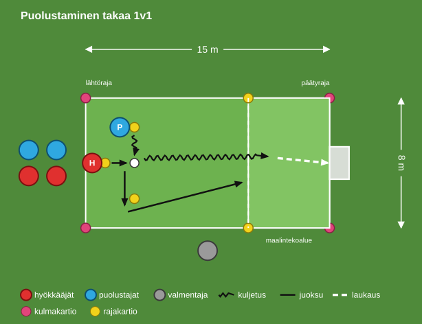

# Puolustaminen takaa 1v1

## Tavoite
Puolustaja oppii juoksemaan takaa kiinni pallollisen hyökkääjän, käyttämään
vartaloa ja käsiä sääntöjen sallimalla tavalla ja pääsemään pallon ja
hyökkääjän väliin. Hyökkääjä oppii kuljettamaan kovassa vauhdissa niin, että
pallo pysyy hallinnassa, ja suojaamaan palloa takaa tulevalta puolustajalta.

## Järjestelyt
- Alue 15 × 8 m (lähtörajalta päätyrajalle 15 m, leveys 8 m). Päätyrajan
  keskellä on pikkumaali, ja sen edessä on 5 metrin syvyinen maalintekoalue,
  jonka raja merkitään sivurajoille kartioilla.
- Noin 3 m lähtörajan edessä on kaksi rajakartiota alueen poikki noin
  4 metrin päässä toisistaan. Hyökkääjän rajakartio on lähtörajan tuntumassa
  niiden puolivälin kohdalla.
- Puolustaja aloittaa pallon kanssa toiselta rajakartiolta ja hyökkääjä
  omalta rajakartioltaan.
- Pelaajat jonottavat parijonona lähtörajan takana. Valmentaja seisoo
  sivurajalla.
- 6–10 pelaajaa per suorituspaikka.
- Välineet: pikkumaali, 9 kartiota (4 kulmiin, 5 rajakartiota), liivit,
  palloja.

## Kulku
1. Puolustaja kuljettaa pallon rajakartiolta kohti toista rajakartiota.
   Puolivälissä hän jättää pallon pysäyttämällä sen jalkapohjalla ja kiertää
   vastakkaisen rajakartion.
2. Kun pallo on pysäytetty, hyökkääjä lähtee omasta aloitteestaan
   rajakartioltaan pallolle ja kuljettaa kohti päätyä. Hän yrittää tehdä
   maalin laukaisemalla pikkumaaliin maalintekoalueelta.
3. Kartion kierrettyään puolustaja puolustaa aktiivisesti: hän juoksee
   hyökkääjän kiinni ja yrittää riistää pallon.
4. Riistosta puolustaja saa pisteen. Hyökkääjä saa pisteen maalista
   pikkumaaliin.
5. Pari palaa sivun kautta jonon perälle, ja seuraava pari aloittaa.
6. Pelaajat vaihtavat rooleja intervallina, esim. 2 minuutin välein.
   Pisteitä kerätään koko harjoitteen ajan.

## Valmennuspisteet
Valitaan 1–2 kerrallaan.
- **1P:** kova kiihdytys kartion jälkeen ja yrittäminen loppuun saakka.
- **1P:** juokse hyökkääjän rinnalle maalin puolelta, ei suoraan pallon perään.
- **1P:** kosketa hyökkääjää ja käytä vartaloa ja käsiä sääntöjen sallimalla
  tavalla.
- **1P:** pyri pallon ja hyökkääjän väliin ja sulje hyökkääjän pallonpuoleinen
  jalka.
- **1H:** kuljeta kovassa vauhdissa, mutta pidä pallo niin lähellä, ettei
  puolustaja pääse väliin.
- **1H:** suojaa palloa vartalolla, kun puolustaja tulee rinnalle.

## Onnistumisen mittari
Puolustajat pääsevät yhä useammin hyökkääjän rinnalle ja pallon ja hyökkääjän
väliin ennen kuin hän ehtii laukaista. Riistot syntyvät vartalon
asettamisella eivätkä takaa potkaisemalla.
