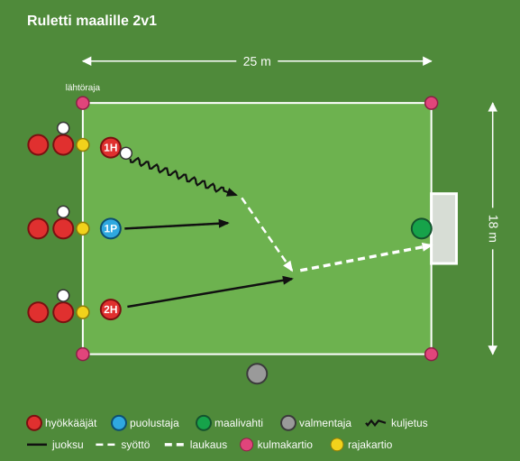

# Ruletti maalille 2v1

## Tavoite
Pelaajat oppivat tunnistamaan roolinsa nopeasti, kun se selviää vasta
lähtöhetkellä. Hyökkääjät oppivat käyttämään 2v1-ylivoiman: pallollinen
painostaa puolustajaa kuljettamalla ja ratkaisee, syöttääkö vai jatkaako
itse, ja pallottomana oleva liikkuu pois puolustajan varjosta. Puolustaja
oppii reagoimaan nopeasti, peittämään syöttölinjan ja hidastamaan
yhteistyössä maalivahdin kanssa.

## Järjestelyt
- Alue 25 × 18 m (lähtörajasta maaliin 25 m, leveys 18 m).
- Alueen päässä on iso maali ja maalivahti.
- Pelaajat jonottavat palloineen kolmessa jonossa lähtörajalla: vasemmalla,
  keskellä ja oikealla. Jonojen kohdat on merkitty kartioilla. Valmentaja
  seisoo sivurajalla.
- 8–12 kenttäpelaajaa ja maalivahti. Kolme suorituspaikkaa mahtuu rinnakkain
  8v8-kentälle (60 × 40 m): kentän pituus jaetaan kolmeen 20 metrin kaistaan,
  ja alue asetetaan kaistalle pitkittäin (25 m kaistan 40 metrin suuntaan),
  jolloin päätyihin jää tilaa jonoille.
- Välineet: iso maali, 7 kartiota (4 kulmiin, 3 lähtörajalle jonojen
  kohdalle), liivit, palloja.

## Kulku
1. Valmentaja huutaa kaksi jonoa: ensin huudetun jonon pelaaja hyökkää pallon
   kanssa ja toisena huudetun jonon pelaaja puolustaa. Kolmannen jonon pelaaja
   on pallottomana toinen hyökkääjä.
2. Pelaajat lähtevät liikkeelle heti huudon jälkeen. Puolustaja jättää
   pallonsa lähtörajalle ja lähtee puolustamaan.
3. Hyökkääjät yrittävät tehdä maalin 2v1-ylivoimaa hyödyntäen.
4. Jos puolustaja voittaa pallon, hän yrittää kuljettaa sen lähtörajan yli.
5. Tilanne päättyy maaliin, torjuntaan, pallon menemiseen ulos tai siihen, että
   puolustaja kuljettaa pallon lähtörajan yli. Pelaajat siirtyvät seuraavan
   jonon perälle, jotta kaikki lähtevät vuorollaan jokaisesta jonosta.
6. Valmentaja vaihtaa huutojen järjestystä joka kierroksella, jotta pelaajat
   eivät tiedä etukäteen rooliaan.

## Valmennuspisteet
Valitaan 1–2 kerrallaan.
- **1H:** painosta puolustajaa kuljettamalla häntä kohti.
- **1H:** tempon muutos puolustajan ohi, kun hän jää odottamaan syöttöä.
- **1H:** syötä, kun puolustaja sitoutuu, ja kuljeta itse, kun puolustaja
  peittää syöttölinjan.
- **2H:** liiku pois puolustajan varjosta.
- **1H ja 2H:** laukaus kummalla tahansa jalalla.
- **1P:** nopea reaktio, kun valmentaja ilmoittaa roolit.
- **1P:** asetu niin, että syöttölinja on varjossa ja pallollinen joutuu
  ratkaisemaan itse.
- **1P ja maalivahti:** hidasta pallollista yhteistyössä maalivahdin kanssa.

## Onnistumisen mittari
Pelaajat lähtevät liikkeelle oikeassa roolissa ilman empimistä, ja
hyökkääjät ratkaisevat tilanteen ennen kuin puolustaja ehtii palata pallon ja
maalin väliin. Puolustajat saavat yhä useammin pallollisen ratkaisemaan itse.
