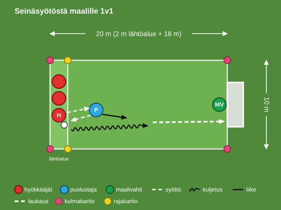

# Seinäsyötöstä maalille 1v1

## Tavoite
Hyökkääjä oppii hyökkäämään puolustajaa kohti vauhdilla, ohittamaan hänet ja
laukaisemaan nopeasti. Puolustaja oppii sulkemaan tilan nopeasti, jarruttamaan
ennen kaksinkamppailua ja ohjaamaan hyökkääjän pois maalin edestä.

## Järjestelyt
- Alue 18 × 10 m (pituus maaliin 18 m, leveys 10 m) ja sen päässä 2 m syvä
  lähtöalue, joka on rajattu rajakartioilla.
- Iso maali ja maalivahti alueen toisessa päässä.
- Hyökkääjät jonottavat palloineen lähtöalueella. Yksi puolustaja on kentällä
  muutaman metrin päässä lähtöviivasta.
- 6–8 kenttäpelaajaa ja maalivahti. Kolme suorituspaikkaa mahtuu rinnakkain
  8v8-kentälle (60 × 40 m), kun kentän pituus jaetaan kolmeen 20 metrin kaistaan.
- Välineet: iso maali, 6 kartiota (4 kulmiin, 2 lähtöviivalle), palloja.

## Kulku
1. Hyökkääjä syöttää puolustajalle, joka syöttää pallon heti takaisin (seinäsyöttö).
2. Hyökkääjä ottaa pallon vastaan ja kuljettaa lähtöviivan yli kohti maalia.
   Seinäsyötön vastaanotosta alkaen hänellä on 5 sekuntia aikaa tehdä maali.
3. Puolustaja lähtee heti kohti kuljettajaa ja yrittää estää läpimurron ja
   voittaa pallon.
4. Hyökkääjä yrittää ohittaa puolustajan ja tehdä maalin maalivahdin ohi.
5. Tilanne päättyy maaliin, pallon menetykseen, pallon menemiseen ulos tai
   aikarajaan. Hyökkääjästä tulee heti uusi puolustaja, ja puolustaja siirtyy
   jonon perälle.

## Valmennuspisteet
Valitaan 1–2 kerrallaan.
- **1H:** ensimmäinen kosketus eteen tai sivulle, jotta peli lähtee käyntiin heti vastaanotosta.
- **1H:** hyökkää puolustajaa kohti vauhdilla, jotta hänen on pakko pysähtyä.
- **1H:** harhautus ajoissa ja kiihdytys ohituksen jälkeen.
- **1H:** nopea laukaus ohituksen jälkeen, sillä aikaa on vain 5 sekuntia.
- **1P:** nopea lähtö syötön jälkeen, jotta hyökkääjällä on vähemmän tilaa ja aikaa.
- **1P:** jarrutus ja matala asento ennen kaksinkamppailua.
- **1P:** ohjaa hyökkääjä kohti sivurajaa, pois maalin edestä.
- **1P:** pysy pallon ja maalin välissä.

## Onnistumisen mittari
Hyökkääjät lähtevät vastaanotosta suoraan eteenpäin ja ehtivät laukaista
aikarajan sisällä. Puolustajat pakottavat yhä useamman hyökkääjän sivulle
pois maalin edestä.
