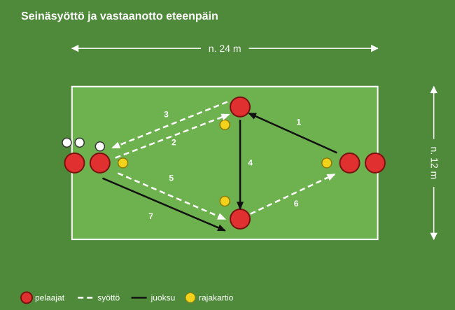

# Seinäsyöttö ja vastaanotto eteenpäin

## Tavoite
Pelaaja oppii liikkumaan pelattavaksi, pelaamaan seinäsyötön yhdellä
kosketuksella ja siirtymään heti uuteen tilaan peliasentoon. Hän ottaa pallon vastaan avoimella
vartalolla niin, että ensimmäinen kosketus kääntää hänet hyökkäyssuuntaan ja
seuraava syöttö lähtee eteenpäin.

## Järjestelyt
- Alue noin 24 × 12 m.
- Lähtökartiot alueen päädyissä noin 16 metrin päässä toisistaan. Keskellä kaksi
  kartiota noin 6 metrin päässä toisistaan.
- 4–6 pelaajaa suorituspaikalla jaettuna kahteen jonoon lähtökartioiden taakse.
  Aloittavalla jonolla on pallot. Isommalle ryhmälle tehdään toinen
  suorituspaikka viereen.
- Välineet: 4 kartiota, palloja.

## Kulku
1. Vastaanottavan jonon ensimmäinen lähtee omasta aloitteestaan ja liikkuu
   keskikartion ulkopuolelle pelattavaksi.
2. Aloittavan jonon ensimmäinen syöttää hänelle heti, kun hän on pelattavissa.
3. Liikkuva pelaaja palauttaa pallon yhdellä kosketuksella seinäsyöttönä.
4. Liikkuva pelaaja siirtyy seinäsyötön jälkeen heti toisen keskikartion
   ulkopuolelle ja asettuu peliasentoon avoimella vartalolla.
5. Syöttäjä syöttää vasta, kun liikkuva pelaaja on peliasennossa. Liikkuva pelaaja
   ottaa pallon vastaan kasvot kohti vastaanottavaa jonoa.
6. Hän syöttää pallon eteenpäin vastaanottavan jonon ensimmäiselle ja siirtyy
   sen jonon perälle.
7. Syöttäjä liikkuu reunalle, jolle liikkuva pelaaja lopetti liikkeensä.
8. Seuraava suoritus lähtee toiseen suuntaan: pallon saanut pelaaja on
   syöttäjä, ja reunalla oleva pelaaja liikkuu hänelle pelattavaksi.
9. Puolta vaihdetaan muutaman minuutin välein, jotta seinäsyöttö ja
   vastaanotto tulevat kummallakin jalalla.

## Valmennuspisteet
Valitaan 1–2 kerrallaan.
- Liiku pelattavaksi ajoissa ja näytä syöttäjälle, mihin haluat pallon.
- Seinäsyöttö yhdellä kosketuksella, tukijalka ja vartalo kohti syöttäjää.
- Siirry seinäsyötön jälkeen heti toiselle reunalle, älä jää katsomaan palloa.
- Ole peliasennossa ennen syöttöä: vartalo auki, paino päkiöillä ja katse
  sekä syöttäjään että eteenpäin.
- Tarkista olan yli ennen vastaanottoa, missä seuraava syöttö on.
- Vastaanotto kaukaisemmalla jalalla avoimella vartalolla niin, että
  ensimmäinen kosketus vie pallon eteenpäin.
- Syöttäjä: syötä vasta, kun liikkuva pelaaja on pelattavissa, ja toinen syöttö
  vasta, kun hän on toisella reunalla peliasennossa.

## Onnistumisen mittari
Liikkuva pelaaja palauttaa seinäsyötön yhdellä kosketuksella ja syöttää
eteenpäin kahdella kosketuksella yhä useammin, myös heikommalla jalalla.
