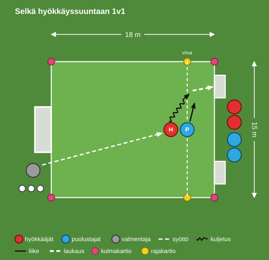

# Selkä hyökkäyssuuntaan 1v1

## Tavoite
Hyökkääjä oppii tarkistamaan olan yli ennen vastaanottoa ja viemään pallon
ensimmäisellä kosketuksella pois puolustajasta sille puolelle, jossa on tilaa,
kun hän saa pallon selkä hyökkäyssuuntaan. Jos kääntyminen ei heti onnistu,
hän suojaa palloa vartalolla. Puolustaja harjoittelee oikeaa etäisyyttä ja
painostusta jo syötön aikana, ja pallon voiton jälkeen siirtymää hyökkäykseen.

## Järjestelyt
- Alue noin 18 × 15 m.
- Hyökkäyspäädyssä kaksi pientä maalia ja noin 3 m niiden edessä poikittainen
  viiva (rajakartiot). Toisessa päässä iso maali.
- Valmentaja seisoo ison maalin vieressä palloineen.
- Hyökkääjät (punaiset) ja puolustajat (siniset) jonottavat pienten maalien takana.
- 6–7 pelaajaa.
- Välineet: iso maali, 2 pientä maalia, 6 kartiota, palloja.

## Kulku
1. Puolustaja asettuu viivalle. Hyökkääjä asettuu hänen eteensä selkä pieniä
   maaleja kohti.
2. Tilanne lähtee liikkeelle hyökkääjän aloitteesta: hyökkääjä lähtee
   liikkeelle ja pyytää syötön valmentajalta. Valmentaja syöttää hyökkääjälle.
   Hyökkääjä tarkistaa olan yli, kääntyy ja yrittää tehdä maalin jompaankumpaan
   pieneen maaliin.
3. Puolustaja painostaa takaa ja yrittää estää kääntymisen.
4. Jos puolustaja voittaa pallon, hän hyökkää isoon maaliin.
5. Valmentaja vaihtaa syöttöpuolta, jotta vastaanottoja tulee molemmilla jaloilla.
6. Tilanne päättyy maaliin, pallon menemiseen ulos tai
   puolustajan maaliyritykseen. Pelaajat palaavat jonoihinsa ja vaihtavat
   rooleja intervalleittain.

## Valmennuspisteet
Valitaan 1–2 kerrallaan.
- **1H:** aloita liike itse ja pyydä pallo selvästi valmentajalta.
- **1H:** katse olan yli ennen vastaanottoa: missä puolustaja on, missä on tilaa.
- **1H:** ensimmäinen kosketus pois puolustajasta, sille puolelle jossa on tilaa.
- **1H:** vartalo pallon ja puolustajan väliin, jos kääntyminen ei heti onnistu.
- **1P:** oikea etäisyys, ei liian kauas eikä kiinni.
- **1P:** painostus jo syötön aikana.

## Onnistumisen mittari
Hyökkääjät tarkistavat olan yli ennen jokaista vastaanottoa ja kääntyvät
ensimmäisellä kosketuksella yhä useammin. Puolustajat ehtivät painostamaan
syötön aikana ilman, että hyökkääjä pääsee kääntymään heidän ohitseen.
