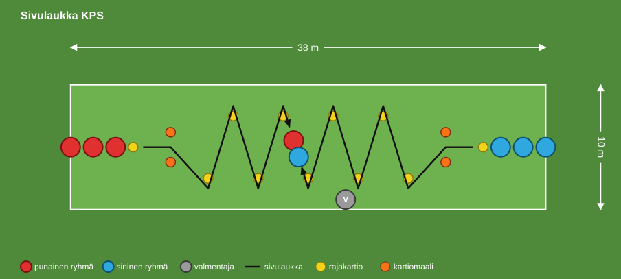

# Sivulaukka KPS

## Tavoite
Pelaaja kehittää sivuttaisliikkumista molempiin suuntiin, jalkojen rytmiä
sekä suunnanmuutosta ja pysähtymistä sivuttaisliikkeestä. Kivi-paperi-sakset-kisa pakottaa pelaajan
pysähtymään ja lähtemään uudelleen liikkeelle heti tuloksen selvittyä.

## Järjestelyt
- Radan päätyihin tehdään porttimaalit kahdesta kartiosta noin 22 metrin
  päähän toisistaan. Kummankin porttimaalin taakse noin 3 metrin päähän
  asetetaan lähtökartio.
- Porttimaalien väliin asetetaan siksak-rata yhdeksästä kartiosta: kartiot
  2 metrin välein radan pituussuunnassa ja vuorotellen 5 metrin päähän
  toisistaan sivusuunnassa.
- Pelaajat jaetaan kahteen ryhmään liiveillä, esimerkiksi 10 pelaajaa,
  5 + 5. Ryhmät asettuvat jonoon oman lähtökartionsa taakse radan
  vastakkaisiin päätyihin. Isommalle ryhmälle tehdään toinen rata viereen.
- Välineet: 15 kartiota, liivit.

## Kulku
1. Kierros alkaa, kun kummankin jonon ensimmäinen lähtee yhtä aikaa
   liikkeelle lähtökartiolta oman porttimaalinsa läpi. Pelaaja katsoo koko
   ajan kohti vastakkaista päätyä ja liikkuu kartiolta kartiolle
   sivulaukalla, vuorotellen vasemmalle ja oikealle. Kartiot kierretään
   ulkopuolelta.
2. Kun pelaajat kohtaavat radalla, he pysähtyvät kasvokkain ja pelaavat
   kivi-paperi-sakset.
3. Hävinnyt poistuu radalta ja palaa oman jononsa perälle. Voittaja
   jatkaa sivulaukkaa samaan suuntaan.
4. Hävinneen ryhmän jonosta lähtee uusi pelaaja lähtökartiolta liikkeelle
   heti kisan päätteeksi, ja hän liikkuu sivulaukalla voittajaa vastaan.
   Kohdatessa pelataan taas kivi-paperi-sakset.
5. Kun pelaaja pääsee vastustajan päädyssä olevan porttimaalin läpi,
   hänen ryhmänsä saa pisteen. Pelaaja palaa oman jononsa perälle.
6. Kierros alkaa alusta: kummankin jonon ensimmäinen lähtee taas yhtä
   aikaa. Eniten pisteitä kerännyt ryhmä voittaa.

## Valmennuspisteet
Valitaan 1–2 kerrallaan.
- Pysy matalassa asennossa, polvet koukussa ja paino päkiöillä.
- Jalat eivät mene ristiin eivätkä kopsahda yhteen.
- Liiku nopein, lyhyin askelin ja pidä lantio ja hartiat kohti vastakkaista päätyä.
- Jarruta kartiolla ulkojalalla ja työnnä heti uuteen suuntaan.
- Uusi lähtijä: seuraa kisaa ja lähde heti, kun tulos on selvä.

## Onnistumisen mittari
Pelaajat liikkuvat koko matkan sivulaukalla matalassa asennossa jalat
ristiin menemättä, vaihtavat suuntaa kartioilla nopeasti, pysähtyvät kohtaamisessa hallitusti ja lähtevät heti
uudelleen liikkeelle.
