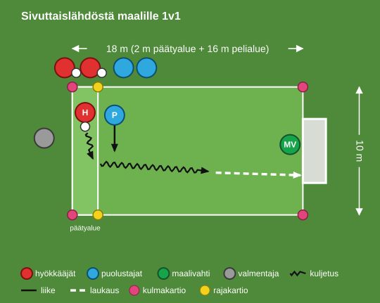

# Sivuttaislähdöstä maalille 1v1

## Tavoite
Hyökkääjä oppii irrottamaan pallon puolustajasta käännöksellä tai leikkauksella,
kiihdyttämään kohti maalia ja viimeistelemään. Puolustaja oppii reagoimaan
nopeasti käännökseen, sulkemaan maalin puoleisen linjan ja ohjaamaan
hyökkääjän pois maalin edestä. Pallon vaihtaessa omistajaa molemmat harjoittelevat
siirtymää.

## Järjestelyt
- Alue 18 × 10 m: lähtöpäädyssä 2 m syvä päätyalue, joka on rajattu
  rajakartioilla, ja sen jälkeen 16 m syvä ja 10 m leveä pelialue.
- Iso maali ja maalivahti alueen toisessa päässä.
- Hyökkääjät jonottavat palloineen päätyalueen kulmassa ja puolustajat
  päätyalueen rajan vieressä. Valmentaja seisoo lähtöpäädyssä.
- 6–8 pelaajaa. Kolme suorituspaikkaa mahtuu rinnakkain 8v8-kentälle (60 × 40 m), kun kentän pituus jaetaan kolmeen 20 metrin kaistaan.
- Välineet: iso maali, 6 kartiota (4 kulmiin, 2 päätyalueen rajalle), palloja.

## Kulku
1. Hyökkääjä asettuu pallon kanssa päätyalueelle ja puolustaja hänen viereensä
   rajan toiselle puolelle pelialueelle. Kumpikin seisoo sivuttain maaliin nähden.
2. Hyökkääjä lähtee liikkeelle omasta aloitteestaan ja kääntyy pallon kanssa
   käännöksellä tai leikkauksella. Ensimmäinen kosketus palloon tehdään
   päätyalueella.
3. Hyökkääjällä on ensimmäisestä kosketuksesta 5 sekuntia aikaa tulla pallon
   kanssa pelialueelle, jonka jälkeen hän hyökkää maaliin.
4. Puolustaja reagoi hyökkääjän aloitteeseen lähtemällä liikkeelle. Hän ei saa
   aloituksessa tulla päätyalueelle, vaan pysyy päätyalueen rajan
   läheisyydessä ja liikkuu rajan suuntaisesti hyökkääjän mukana, jolloin
   hyökkääjän on päästävä pelialueelle käännösten, leikkausten ja harhautusten
   avulla. Puolustaja yrittää estää läpimurron ja voittaa pallon.
5. Hyökkääjä yrittää tehdä maalin maalivahdin ohi.
6. Jos puolustaja voittaa pallon, hän yrittää kuljettaa sen lähtöpäädyn rajan
   yli (siirtymä). Hyökkääjä yrittää heti voittaa pallon takaisin.
7. Tilanne päättyy maaliin, puolustajan kuljetukseen rajan yli, pallon
   menemiseen ulos tai siihen, ettei hyökkääjä ehdi pelialueelle 5 sekunnissa.
   Pelaajat palaavat omiin jonoihinsa.
8. Hyökkääjät ja puolustajat vaihtavat rooleja intervalleittain.

## Valmennuspisteet
Valitaan 1–2 kerrallaan.
- **1H:** suunnanmuutos käännöksellä tai leikkauksella jo ensimmäisellä kosketuksella päätyalueella, jotta pallo irtoaa puolustajasta heti alussa.
- **1H:** harhautukset päätyalueella, jotta puolustaja lähtee väärään suuntaan ennen pelialueelle tuloa.
- **1H:** tempon muutos: kiihdytys heti käännöksen jälkeen kohti maalia.
- **1H:** vartalo pallon ja puolustajan väliin suojaamaan palloa.
- **1H:** pallon menetyksen jälkeen heti puolustamaan, ettei puolustaja pääse kuljettamaan rajan yli.
- **1P:** pysy päätyalueen rajan läheisyydessä ja liiku rajan suuntaisesti hyökkääjän mukana; älä lähde harhautuksiin.
- **1P:** nopea reaktio hyökkääjän aloitteeseen ja käännökseen ja maalin puoleisen linjan sulkeminen.
- **1P:** jarrutus ja matala asento ennen kaksinkamppailua, ettei hyökkääjä pääse ohi suunnanmuutoksella.
- **1P:** ohjaa hyökkääjä kohti sivurajaa, pois maalin edestä.
- **1P:** pallon voiton jälkeen nopea kuljetus lähtöpäädyn rajan yli.

## Onnistumisen mittari
Hyökkääjät saavat käännöksellä etumatkan ja pääsevät laukaisemaan yhä useammin.
Puolustajat ehtivät maalin puoleiselle linjalle ja ohjaavat hyökkääjiä sivulle,
ja pallon voitot johtavat kuljetukseen lähtöpäädyn rajan yli.
