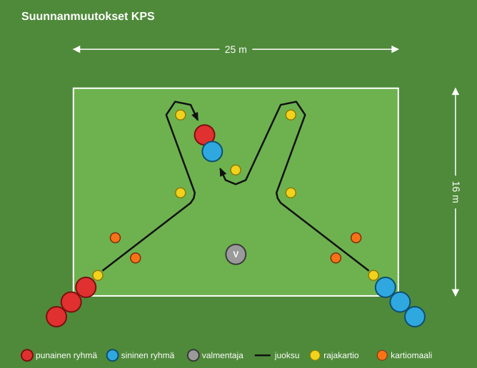

# Suunnanmuutokset KPS

## Tavoite
Pelaaja kehittää suunnanmuutoksia eri kulmiin sekä jarrutusta ja
kiihdytystä. Kivi-paperi-sakset-kisa pakottaa pelaajan pysähtymään ja
lähtemään uudelleen liikkeelle heti tuloksen selvittyä.

## Järjestelyt
- Rata tehdään kuudesta noin 6 metrin osuudesta. Osuuksien väliin
  asetetaan käännöskartio, ja käännökset ovat järjestyksessä 45°, 135°,
  90°, 135° ja 45°. Rata on symmetrinen, joten molemmista päistä
  lähtevät tekevät samat käännökset.
- Radan molempiin päihin tehdään porttimaali kahdesta kartiosta.
  Porttimaalin taakse noin 3 metrin päähän asetetaan lähtökartio.
- Pelaajat jaetaan kahteen ryhmään liiveillä, esimerkiksi 10 pelaajaa,
  5 + 5. Ryhmät asettuvat jonoon oman lähtökartionsa taakse radan
  vastakkaisiin päihin. Isommalle ryhmälle tehdään toinen rata viereen.
- Välineet: 11 kartiota, liivit.

## Kulku
1. Kierros alkaa, kun kummankin jonon ensimmäinen lähtee yhtä aikaa
   liikkeelle lähtökartiolta oman porttimaalinsa läpi ja juoksee rataa
   pitkin kohti vastustajan päätä. Käännöskartiot kierretään aina ulkopuolelta.
2. Kun pelaajat kohtaavat radalla, he pysähtyvät kasvokkain ja pelaavat
   kivi-paperi-sakset.
3. Hävinnyt poistuu radalta ja palaa oman jononsa perälle. Voittaja
   jatkaa juoksua samaan suuntaan.
4. Hävinneen ryhmän jonosta lähtee uusi pelaaja lähtökartiolta liikkeelle
   heti kisan päätteeksi, ja hän juoksee voittajaa vastaan. Kohdatessa pelataan taas
   kivi-paperi-sakset.
5. Kun pelaaja pääsee vastustajan päässä olevan porttimaalin läpi, hänen
   ryhmänsä saa pisteen. Pelaaja palaa oman jononsa perälle.
6. Kierros alkaa alusta: kummankin jonon ensimmäinen lähtee taas yhtä
   aikaa. Eniten pisteitä kerännyt ryhmä voittaa.

## Valmennuspisteet
Valitaan 1–2 kerrallaan.
- Jarruta ennen käännöstä lyhyillä askelilla ja laske painopistettä.
- 45 asteen käännöksessä säilytä vauhti ja käänny juoksuaskelin.
- 90 ja 135 asteen käännöksessä pysähdy ulkojalalle ja työnnä uuteen
  suuntaan.
- Kierrä kartio tiukasti, katse jo uudessa suunnassa.
- Kiihdytä jokaisen käännöksen ja kivi-paperi-saksien jälkeen heti
  täyteen vauhtiin.

## Onnistumisen mittari
Pelaajat kiertävät kartiot tiukasti ja hallitusti, eivät liukastu tai
kaarra leveästi jyrkissä käännöksissä, ja kiihdyttävät jokaisen
käännöksen jälkeen täyteen vauhtiin.
