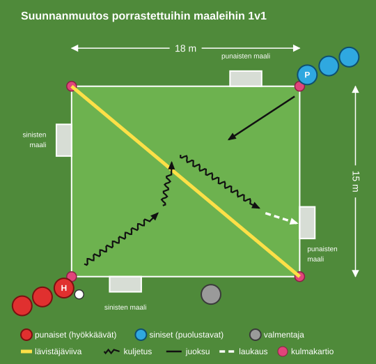

# Suunnanmuutos porrastettuihin maaleihin 1v1

## Tavoite
Hyökkääjä oppii näyttämään yhteen maaliin ja vaihtamaan suuntaa toiseen, kun
maalit avautuvat eri suuntiin. Puolustaja oppii lähtemään nopeasti vastaan,
jarruttamaan ennen kaksinkamppailua ja asettumaan kahden maalin väliin niin,
ettei kumpikaan jää helposti auki.

## Järjestelyt
- Alue 18 × 15 m. Ruudun poikki kulkee vasemmasta yläkulmasta oikeaan
  alakulmaan lävistäjäviiva, jonka voi merkitä kartioilla tai lautasilla.
- Ruudun jokaisella sivulla on pikkumaali, joka on siirretty sivun toiseen
  päähän noin 3 m kulmasta (porrastettu). Maalit kiertävät ruudun ympäri
  samaan suuntaan kuin tuulimyllyn siivet.
- Pelaajat jaetaan kahteen joukkueeseen, punaisiin ja sinisiin. Kummallakin
  joukkueella on kaksi omaa maalia, joihin se hyökkää, ja se puolustaa
  vastustajan kahta maalia:
  - punaisten maalit: ylärajan maali (oikealla) ja oikean sivun maali
    (alhaalla)
  - sinisten maalit: vasemman sivun maali (ylhäällä) ja alarajan maali
    (vasemmalla)
- Punaiset jonottavat palloineen vasemman alakulman takana ja siniset
  oikean yläkulman takana. Valmentaja seisoo sivurajalla.
- 6–8 pelaajaa per suorituspaikka. Kolme suorituspaikkaa mahtuu rinnakkain
  8v8-kentälle (60 × 40 m): kentän pituus jaetaan kolmeen 20 metrin kaistaan.
- Välineet: 4 pikkumaalia, 4 kulmakartiota, lautasia lävistäjäviivalle,
  liivit, palloja.

## Kulku
1. Hyökkäävän joukkueen pelaaja lähtee omasta aloitteestaan pallon kanssa
   kulmastaan. Puolustavan joukkueen pelaaja lähtee samalla hetkellä
   vastakkaisesta kulmasta.
2. Hyökkääjän on kuljetettava pallo lävistäjäviivan yli ennen kuin hän voi
   tehdä maalin. Sen jälkeen hän yrittää tehdä maalin jompaankumpaan
   oman joukkueensa maaliin. Kun punaiset hyökkäävät, hyökkääjän maalit ovat
   ylärajan ja oikean sivun maalit, ja puolustaja suojaa niitä.
3. Puolustaja spurttaa painostamaan ja yrittää voittaa pallon.
4. Jos puolustaja voittaa pallon, hän hyökkää oman joukkueensa maaleihin
   (sinisillä vasemman sivun ja alarajan maalit), ja hyökkääjä siirtyy
   puolustamaan niitä. Maalin saa tehdä vasta, kun pallo on omien maalien
   puolella lävistäjäviivaa.
5. Tilanne päättyy maaliin tai siihen, että pallo menee alueen ulos.
   Pelaajat palaavat oman jononsa perälle, ja seuraava pari aloittaa.
6. Joukkueet vaihtavat rooleja intervallina, esim. 2 minuutin välein: silloin
   siniset hyökkäävät oikeasta yläkulmasta vasemman sivun ja alarajan
   maaleihin, ja punaiset puolustavat niitä.

## Valmennuspisteet
Valitaan 1–2 kerrallaan.
- **1H:** hyökkää siihen maaliin, jonka puolustaja jättää auki.
- **1H:** vartaloharhautus – näytä yhteen maaliin ja lähde toiseen.
- **1H:** kiihdytys heti harhautuksen jälkeen puolustajan ohi.
- **1H:** pallo lähellä jalkoja, jotta suuntaa voi vaihtaa nopeasti.
- **1P:** spurtti painostamaan heti, kun hyökkääjä lähtee.
- **1P:** jarrutus ja matala asento ennen kaksinkamppailua.
- **1P:** asetu kahden maalin väliin niin, ettei kumpikaan ole helposti auki.
- **Pallon vaihtaessa omistajaa:** riistäjä kääntyy heti kohti oman joukkueen
  maaleja; pallon menettänyt siirtyy heti puolustamaan.

## Onnistumisen mittari
Hyökkääjät tekevät maaleja kumpaankin maaliin suunnanmuutoksen jälkeen eivätkä
hyökkää aina samaan. Puolustajat pakottavat hyökkääjän yhä useammin
valitsemaan suunnan liian aikaisin. Pisteitä lasketaan joukkueittain.
