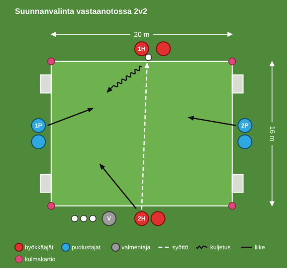

# Suunnanvalinta vastaanotossa 2v2

## Tavoite
Vastaanottaja oppii katsomaan ennen vastaanottoa, mistä paine tulee, ja
valitsemaan ensimmäisellä kosketuksella hyökkäyssuunnan pois paineesta.
Puolustajat harjoittelevat painostamista ja nopeaa vastahyökkäystä riiston jälkeen.

## Järjestelyt
- Kenttä 20 × 16 m, kaksi pikkumaalia (2 m) kummassakin päädyssä.
- 8 pelaajaa, kaksi neljän hengen joukkuetta (toisella liivit).
- Hyökkääjät (punainen): kaksi pelaajaa kummallakin pitkällä sivulla keskellä.
- Puolustajat (sininen): kaksi pelaajaa kummassakin päädyssä maalien välissä.
- Valmentaja pallovaraston kanssa alasivulla.

## Kulku
1. Alasivun hyökkääjä (2H) syöttää vastakkaisen sivun hyökkääjälle (1H).
2. Samaan aikaan kummastakin päädystä lähtee yksi puolustaja (1P, 2P), ja 2H
   tulee kentälle tueksi – pelataan 2v2.
3. 1H:n ensimmäinen kosketus ratkaisee hyökkäyssuunnan: hyökkääjät hyökkäävät
   sen päädyn kahteen maaliin, johon vastaanotto suuntautuu.
4. Jos puolustajat riistävät, he yrittävät tehdä maalin vastakkaisen päädyn
   kahteen maaliin.
5. Tilanne päättyy maaliin tai pallon mentyä ulos; seuraavat pelaajat jonoista aloittavat.
6. Joukkueet vaihtavat rooleja 6 hyökkäyskerran jälkeen. Värit kuvaavat
   roolia: hyökkääjät ovat kaaviossa aina punaisia ja puolustajat sinisiä.

## Valmennuspisteet
- **1H:** katso olan yli ennen vastaanottoa, kumpi puolustaja on lähempänä;
  avaa vartalo ja ota ensimmäinen kosketus pois paineesta – suunta valitaan ennen palloa.
- **2H:** liiku syötön jälkeen ulos varjosta ja tarjoa syöttösuunta
  valitun hyökkäyssuunnan puolelle.
- **1P:** painosta vastaanottajaa nopeasti ja ohjaa hänet kohti toista puolustajaa.
- **2P:** peitä 1P:n selusta ja 2H:n syöttölinja.
- **Riiston jälkeen:** puolustajat pelaavat heti eteenpäin vastakkaisen päädyn maaleja kohti.

## Onnistumisen mittari
Hyökkääjien ensimmäinen kosketus vie pallon poispäin lähimmästä puolustajasta,
ja hyökkäävä pari saa maalin vähintään puolessa kuudesta hyökkäyksestä.
