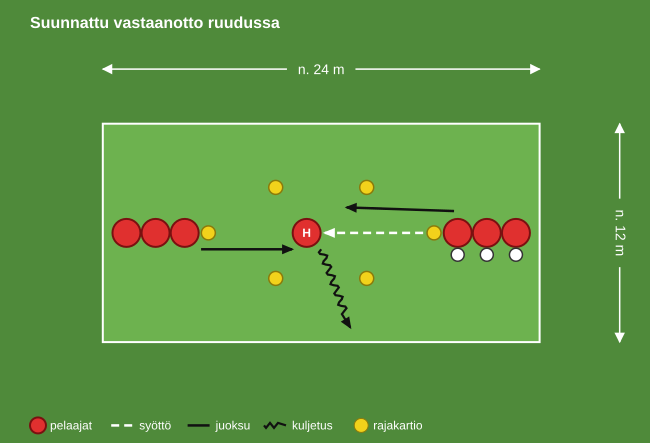

# Suunnattu vastaanotto ruudussa

## Tavoite
Pelaaja oppii tulemaan palloa vastaan liikkeessä ja ohjaamaan pallon
ensimmäisellä kosketuksella pois syötön linjalta, ruudun sivusta ulos.
Samalla harjoitellaan tarkkaa maasyöttöä liikkuvalle pelaajalle.

## Järjestelyt
- Alue noin 24 × 12 m. Keskelle 5 × 5 m:n ruutu neljällä kartiolla.
- Molemmin puolin ruutua, noin 7 m päähän, lähtökartio ja sen taakse jono.
- 6–8 pelaajaa, puolet kummassakin jonossa. Isommalle ryhmälle tehdään toinen
  suorituspaikka viereen.
- Välineet: 6 kartiota, pallo noin joka toisella pelaajalla.

## Kulku
1. Jonon ensimmäinen syöttää maata pitkin ruutuun saapuvalle pelaajalle.
2. Ruutuun saapunut pelaaja ottaa pallon vastaan ja ohjaa sen ensimmäisellä
   kosketuksella vinosti ruudun sivusta ulos, vasemmalle tai oikealle. Sen
   jälkeen hän kuljettaa pallon jonon perään:
   - vino kosketus eteenpäin: siihen jonoon, josta syöttö tuli
   - vino kosketus taaksepäin: siihen jonoon, josta hän itse lähti.
3. Syöttäjä lähtee ruutuun vasta, kun edellinen pelaaja on ohjannut pallon
   kosketuksella ruudusta ulos.
4. Ruutuun juossut syöttäjä on seuraava vastaanottaja, ja vastakkaisen jonon
   ensimmäinen syöttää hänelle. Näin syöttösuunta vaihtuu joka kierroksella.
5. Valmentaja päättää, harjoitellaanko vinoa kosketusta eteen- vai
   taaksepäin. Vastaanottaja valitsee itse, kummalle sivulle hän pallon ohjaa.

## Valmennuspisteet
Valitaan 1–2 kerrallaan.
- **Vastaanottaja:** tule palloa vastaan, älä jää odottamaan.
- **Vastaanottaja:** vartalo auki siihen suuntaan, johon pallo ohjataan.
- **Vastaanottaja:** ensimmäinen kosketus ulos syötön linjalta ja niin pitkä,
  että seuraava kosketus on jo kuljetusta.
- **Vastaanottaja:** vastaanotto kauemmalla jalalla, kun pallo ohjataan sivulle.
- **Vastaanottaja:** molempien jalkojen ja sivujen käyttö.
- **Vastaanottaja:** eri vastaanottotekniikat: sisäsyrjä, ulkosyrjä tukijalan
  takaa, jalkapohjapysäytys ja käännös takaisin omaan jonoon.
- **Syöttäjä:** maasyöttö vastaanottajan etujalalle, sopivalla vauhdilla.
- **Syöttäjä:** ajoita lähtö ruutuun edellisen pelaajan ensimmäiseen kosketukseen.

## Onnistumisen mittari
Pallo lähtee ensimmäisellä kosketuksella ruudun sivusta ulos ilman toista
korjaavaa kosketusta yhä useammin, myös heikommalla jalalla.
