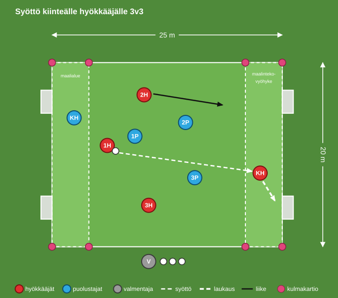

# Syöttö kiinteälle hyökkääjälle 3v3

## Tavoite
Joukkue avaa pallon omalta alueelta ja pelaa sen paineen läpi syvälle
kiinteälle hyökkääjälle. Kenttäpelaajat seuraavat syötön perässä tueksi ja
luovat maalialueelle ylivoiman.

## Järjestelyt
- Kenttä 25 × 20 m, kummassakin päädyssä kaksi pikkumaalia.
- Kummankin päädyn eteen merkitään kartioilla 4 m syvä maalialue.
- Kummallakin joukkueella on kolme kenttäpelaajaa ja kiinteä hyökkääjä, joka
  pysyy vastustajan maalialueella eikä palaa puolustamaan. Yksi vaihtopelaaja
  kummallakin joukkueella.
- Valmentaja pallovaraston kanssa sivurajalla.

## Kulku
1. Peli alkaa omalta päätyrajalta syöttämällä tai kuljettamalla: aluksi,
   maalin jälkeen ja kun pallo menee yli päätyrajan.
2. Kenttäpelaajat pelaavat koko kentällä 3v3. Pallollinen joukkue yrittää
   syöttää pallon kiinteälle hyökkääjälle. Maali hyväksytään vain, jos
   pallo on kulkenut hyökkäyksen aikana kiinteän hyökkääjän kautta.
3. Kiinteän hyökkääjän syötön jälkeen maalin saa tehdä kuka tahansa
   hyökkäävän joukkueen pelaaja, mutta vain vastustajan maalialueelta.
   Puolustajat saavat puolustaa myös maalialueella.
4. Kiinteä hyökkääjä ei puolusta. Kun hänen joukkueensa menettää pallon,
   hän jää maalialueelle odottamaan seuraavaa hyökkäystä.
5. Intervallit, esim. 4 × 3 min. Kiinteä hyökkääjä ja vaihtopelaaja vaihtuvat
   intervallien välissä.

## Valmennuspisteet
- **1H:** katso ensin kiinteää hyökkääjää. Jos syöttölinja on auki, syötä
  syvälle heti. Jos ei, kuljeta tai syötä lähimmälle tuelle.
- **2H:** tue pallollista syöttökulmassa ja lähde kiinteälle hyökkääjälle
  menevän syötön perässä tueksi (2v1 maalialueella).
- **3H:** anna leveyttä ja venytä puolustusta, jotta syöttölinja kiinteälle
  hyökkääjälle aukeaa.
- **Kiinteä hyökkääjä:** liiku pois puolustajan varjosta ja ota pallo vastaan
  avoimella vartalolla.
- **1P, 2P, 3P:** 1P painostaa pallollista ja sulkee syöttölinjan kiinteälle
  hyökkääjälle, 2P ja 3P peittävät syöttölinjoja ja tilaa maalialueen edessä.

## Onnistumisen mittari
Pallo kulkee omalta alueelta kiinteälle hyökkääjälle muutamalla syötöllä, ja
syötön perään tulee tuki, josta syntyy maalipaikka.
