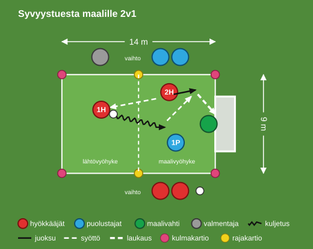

# Syvyystuesta maalille 2v1

## Tavoite
Pallollinen hyökkääjä oppii sitomaan puolustajan kuljettamalla häntä kohti ja
ratkaisemaan, syöttääkö vai laukaiseeko itse. Pallottomana syvyystukena oleva
hyökkääjä oppii liikkumaan pois puolustajan varjosta niin, että syöttölinja
aukeaa, ja viimeistelemään nopeasti. Puolustaja oppii peittämään syöttölinjan,
hidastamaan pallollista ja tekemään yhteistyötä maalivahdin kanssa.

## Järjestelyt
- Alue 14 × 9 m (pituus maaliin 14 m, leveys 9 m).
- Alue jaetaan keskeltä sivujen kartioilla kahteen 7 metrin vyöhykkeeseen:
  lähtövyöhykkeeseen ja maalivyöhykkeeseen.
- Alueen päässä on iso maali ja maalivahti.
- Maalivyöhykkeessä on yksi puolustaja ja yksi hyökkääjä pallon kanssa,
  lähtövyöhykkeessä yksi hyökkääjä ilman palloa. Hyökkääjien vaihtopelaajat
  jonottavat palloineen alueen ulkopuolella maalivyöhykkeen vieressä, ja
  puolustajien vaihtopelaajat omassa jonossaan maalivyöhykkeen vastakkaisella
  puolella. Valmentaja seisoo sivurajalla.
- 5–8 kenttäpelaajaa ja maalivahti suorituspaikkaa kohden. Isommalle ryhmälle
  tehdään toinen suorituspaikka viereen. Kolme suorituspaikkaa mahtuu
  rinnakkain 8v8-kentälle (60 × 40 m): kentän pituus jaetaan kolmeen 20 metrin
  kaistaan, ja kunkin kaistan pituussuunnasta jää tilaa jonoille.
- Välineet: iso maali (esim. 5v5-maali), 6 kartiota (4 kulmiin, 2
  vyöhykerajalle), liivit, palloja.

## Kulku
1. Maalivyöhykkeessä oleva hyökkääjä aloittaa tilanteen omasta aloitteestaan
   syöttämällä pallon lähtövyöhykkeessä olevalle hyökkääjälle.
2. Lähtövyöhykkeen hyökkääjä ottaa pallon vastaan ja kuljettaa kohti
   vyöhykerajaa. Syöttäjä liikkuu maalivyöhykkeessä niin, että hän on
   pelattavissa.
3. Kun pallo tulee maalivyöhykkeeseen kuljettamalla tai syöttämällä, siellä
   pelataan 2v1. Puolustaja pysyy maalivyöhykkeessä.
4. Hyökkääjät yrittävät tehdä maalin maalivahdin ohi.
5. Tilanne päättyy maaliin, torjuntaan, pallon menemiseen ulos tai siihen, että
   puolustaja voittaa pallon. Pallon voittanut puolustaja syöttää pallon
   valmentajalle.
6. Kierto: maalivyöhykkeen hyökkääjä siirtyy lähtövyöhykkeelle, lähtövyöhykkeen
   hyökkääjä vaihtopelaajien jonoon ja jonon ensimmäinen pallon kanssa
   maalivyöhykkeelle.
7. Puolustaja vaihtuu kolmen hyökkäyksen välein: hän menee puolustajien jonon
   perälle, ja jonon ensimmäinen tulee puolustamaan.

## Valmennuspisteet
Valitaan 1–2 kerrallaan.
- **1H:** ensimmäinen kosketus eteenpäin, jotta kuljetus lähtee heti vauhdilla.
- **1H:** kuljeta puolustajaa kohti, jotta hänen on pakko sitoutua palloon.
- **1H:** syötä, kun puolustaja sitoutuu, ja laukaise itse, kun puolustaja
  peittää syöttölinjan.
- **2H:** tarkka aloitussyöttö ja heti liikkeelle syötön jälkeen.
- **2H:** liiku pois puolustajan varjosta syvyyteen tai leveyteen, jotta
  syöttölinja aukeaa.
- **2H:** laukaus kummalla tahansa jalalla, mieluiten ensimmäisellä kosketuksella.
- **1P:** asetu niin, että syöttölinja on varjossa ja pallollinen joutuu
  ratkaisemaan itse.
- **1P:** hidasta pallollista ennen kuin hän pääsee laukaisupaikalle, mutta älä
  sitoudu liian aikaisin.
- **1P ja maalivahti:** maalivahti ottaa laukaisijan, puolustaja syöttölinjan.

## Onnistumisen mittari
Vastaanotot lähtevät eteenpäin ilman pysähtymistä, pallolliset tulevat vyöhykerajan yli puolustajaa kohti eivätkä syötä liian
aikaisin, ja syvyystuki on syötön hetkellä varjon ulkopuolella. Maalit syntyvät
sekä syötöistä että omista laukauksista sen mukaan, mitä puolustaja tekee.
