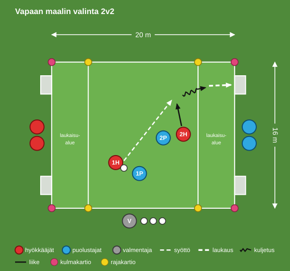

# Vapaan maalin valinta 2v2

## Tavoite
Hyökkääjät oppivat katsomaan ennen vastaanottoa, kumpi maaleista on vapaana,
ja viemään pallon ensimmäisellä kosketuksella pois paineesta sitä kohti.
Puolustajat harjoittelevat parina kahden maalin suojaamista.

## Järjestelyt
- Kenttä 20 × 16 m, kaksi pikkumaalia (2 m) kummassakin päädyssä, ei maalivahteja.
- Laukaisualue 4 m kummankin päätyrajan edessä (rajakartiot ja viiva).
- 8 pelaajaa, kaksi neljän hengen joukkuetta (toisella liivit).
- Kentällä 2v2, kummankin joukkueen toinen pari odottaa omien maaliensa takana.
- Valmentaja pallovaraston kanssa sivurajalla.

## Kulku
1. Kumpikin joukkue hyökkää vastakkaisen päädyn kahteen maaliin ja puolustaa omia kahta.
2. Maalin saa tehdä vain laukaisualueelta.
3. Maalin tai päätyrajan ylityksen jälkeen puolustanut joukkue aloittaa
   kuljettamalla pallon sisään omalta päätyrajaltaan.
4. Sivurajan ylityksen jälkeen peli jatkuu kuljettamalla sisään sivurajalta.
5. Odottava pari vaihtuu sisään noin 90 sekunnin välein.

## Valmennuspisteet
- **1H:** katso ennen syöttöä, kummalla puolella puolustajia on vähemmän;
  vaihda tarvittaessa pelin painopistettä toiseen maaliin.
- **2H:** liiku ulos puolustajan varjosta ennen syöttöä ja tarkista olan yli,
  kumpi maali on vapaana; ensimmäinen kosketus pois paineesta sitä kohti.
- **1P:** painosta pallollista ja ohjaa hänet kohti sivurajaa.
- **2P:** pysy pallon puolella ja peitä 2H:n syöttölinja, mutta älä jätä toista maalia tyhjäksi.
- **Kaikki:** maali vain laukaisualueelta – hae tilaa ja ajoitusta, älä laukaise kaukaa.

## Onnistumisen mittari
Hyökkääjät tekevät suurimman osan maaleistaan vapaaseen maaliin pelin
painopisteen vaihdon tai ensimmäisen kosketuksen suunnanmuutoksen jälkeen.
