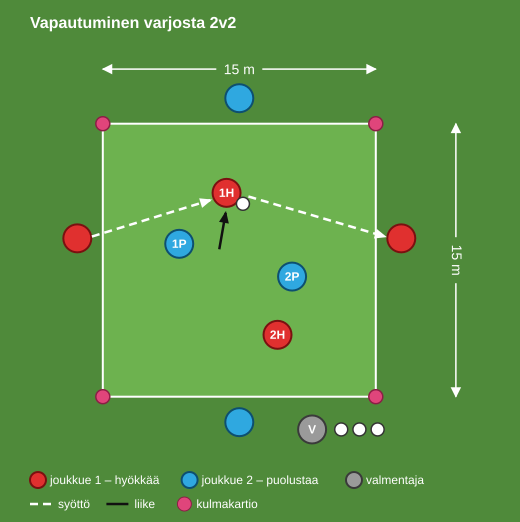

# Vapautuminen varjosta 2v2

## Tavoite
Keskipelaajat oppivat irtautumaan puolustajan varjosta syöttölinjalle ja
valmistelemaan ensimmäisen kosketuksen niin, että pallo jatkaa päädystä
toiseen. Puolustajat harjoittelevat syöttölinjojen sulkemista ja riistoa,
ja molemmat joukkueet nopeaa roolinvaihtoa riiston jälkeen.

## Järjestelyt
- Neliö 15 × 15 m, kartiot kulmissa.
- 8 pelaajaa, kaksi neljän hengen joukkuetta (toisella liivit).
- Kummallakin joukkueella kaksi päätypelaajaa ja kaksi keskipelaajaa.
- Joukkue 1 (punainen, aloittaa hyökkääjänä): päätypelaajat kahdella
  vastakkaisella sivulla.
- Joukkue 2 (sininen, aloittaa puolustajana): päätypelaajat kahdella muulla
  sivulla – joukkueet pelaavat ristiin.
- Valmentaja pallovaraston kanssa ruudun ulkopuolella.

## Kulku
1. Hyökkäävän joukkueen päätypelaaja syöttää keskelle vapautuneelle keskipelaajalle (1H).
2. Keskellä pelataan 2v2: hyökkääjät yrittävät viedä pallon vastakkaiselle
   päätypelaajalle, puolustajat (1P, 2P) yrittävät riistää.
3. Onnistunut läpipeli = piste; päätypelaaja jatkaa peliä takaisin toiseen suuntaan.
4. Kun puolustava joukkue riistää, se pelaa pallon aina omalle päätypelaajalleen,
   jolloin joukkueiden roolit vaihtuvat ja peli jatkuu heti toiseen suuntaan.
5. Jos pallo menee ulos, valmentaja syöttää uuden pallon sille joukkueelle,
   joka ei vienyt palloa ulos.
6. Intervallit, esim. 4 × 3 min; päätypelaajat ja keskipelaajat vaihtavat
   paikkaa intervallien välillä.

## Valmennuspisteet
- **1H:** liiku ulos varjosta ennen syöttöä, avaa vartalo ja ota ensimmäinen
  kosketus menosuuntaan – molemmilla jaloilla.
- **2H:** ota kulma 1H:hon, jotta syöttövaihtoehto on aina tarjolla.
- **Päätypelaaja:** katso ennen syöttöä, kumpi keskipelaaja on vapaana; syötä etummaiselle jalalle.
- **1P:** sulje pallollisen syöttölinja ja pakota kääntymään taaksepäin.
- **2P:** pidä keskimmäinen syöttölinja varjossa ja lue seuraava syöttö.
- **Roolinvaihto:** riiston jälkeen katse heti omaan päätypelaajaan; pallon
  menettänyt joukkue siirtyy välittömästi puolustamaan.
- **Kaikki:** katso olan yli ennen vastaanottoa.

## Onnistumisen mittari
Hyökkääjät saavat pallon päädystä toiseen useammin kuin puolustajat riistävät,
ja keskipelaaja kääntyy eteenpäin enintään kahdella kosketuksella.

