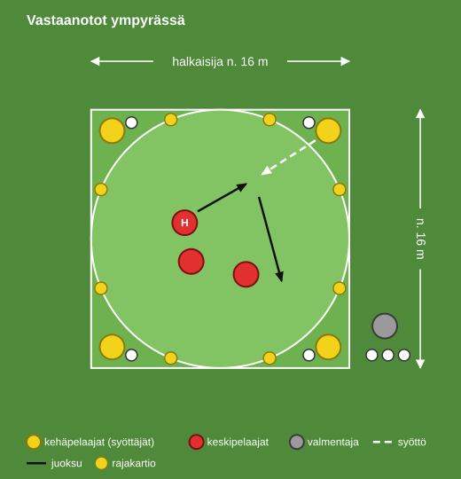

# Vastaanotot ympyrässä

## Tavoite
Keskipelaaja oppii liikkumaan vinosti kohti vapaata syöttäjää niin, että
vartalo on auki, ja ottamaan pallon vastaan eri pinnoilla kummallakin jalalla.
Ensimmäisellä kosketuksella hän kääntyy kohti seuraavaa syöttäjää.

## Järjestelyt
- Ympyrä, halkaisija noin 15–18 m, rajattu 6–9 kartiolla.
- 6–7 pelaajaa: 4 syöttäjää kehällä palloineen, 2–3 keskipelaajaa keskellä
  ilman palloa.
- Valmentaja ympyrän laidalla pallovaraston kanssa.
- Välineet: 6–9 kartiota, palloja.

## Kulku
1. Keskipelaaja lähtee vinosti kohti vapaata syöttäjää, jolloin vartalo on auki.
2. Syöttäjä syöttää tai heittää pallon. Keskipelaaja ottaa sen vastaan
   valmentajan määräämällä pinnalla: sisäsyrjällä, ulkosyrjällä, reidellä tai
   rinnalla.
3. Keskipelaaja palauttaa pallon ja hakee seuraavan syöttäjän.
4. Roolit vaihtuvat muutaman minuutin välein.

## Valmennuspisteet
Valitaan 1–2 kerrallaan.
- **Keskipelaaja:** avoin vartalo pallon vastaanotossa.
- **Keskipelaaja:** käännös ensimmäisellä kosketuksella kohti seuraavaa syöttäjää.
- **Keskipelaaja:** ensimmäinen kosketus eri pinnoilla.
- **Keskipelaaja:** molempien jalkojen käyttö.
- **Keskipelaaja:** kommunikointi: pyydä syöttöä tai heittoa kuuluvalla äänellä.
- **Syöttäjä:** syötä vasta, kun keskipelaaja on liikkeellä ja vartalo auki.

## Onnistumisen mittari
Keskipelaajat lähtevät syöttäjää kohti vinosti ja kääntyvät ensimmäisellä
kosketuksella kohti seuraavaa syöttäjää yhä useammin, myös heikommalla jalalla.
