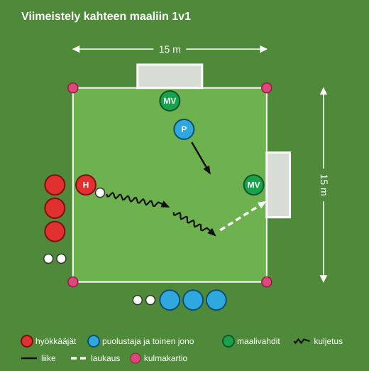

# Viimeistely kahteen maaliin 1v1

## Tavoite
Hyökkääjä oppii hyökkäämään rohkeasti puolustajaa vastaan, ohittamaan hänet ja
viimeistelemään nopeasti maalivahdin ohi. Hyökkäyksen jälkeen pelaaja siirtyy
heti puolustamaan, ehtii seuraavan hyökkääjän ja maalin väliin ja estää laukauksen.

## Järjestelyt
- Neliö 15 × 15 m, kulmissa kartiot.
- Maalit kahdella vierekkäisellä reunalla, kummallakin maalilla maalivahti.
- Hyökkääjien jonot kahdella muulla reunalla, kummankin reunan keskellä.
  Vasemman reunan jono hyökkää vastakkaisen reunan maaliin ja alareunan jono
  yläreunan maaliin. Jokaisella jonon pelaajalla on pallo.
- 8 kenttäpelaajaa ja 2 maalivahtia. Isommalle ryhmälle tehdään toinen
  suorituspaikka viereen.
- Välineet: 2 isoa maalia, 4 kartiota, palloja.

## Kulku
1. Ensimmäinen hyökkääjä lähtee omasta aloitteestaan ilman puolustajaa ja
   viimeistelee maaliin. Laukauksen jälkeen hänestä tulee puolustaja.
2. Toisen jonon ensimmäinen pelaaja lähtee hyökkäämään omasta aloitteestaan
   heti, kun edellinen tilanne päättyy. Puolustaja reagoi ja yrittää ehtiä
   hyökkääjän ja maalin väliin.
3. Hyökkääjä yrittää ohittaa puolustajan ja tehdä maalin.
4. Tilanne päättyy maaliin, maalivahdin torjuntaan, pallon menemiseen ulos tai
   puolustajan pallonriistoon. Puolustaja siirtyy oman jononsa perälle ja
   hyökkääjästä tulee seuraava puolustaja.
5. Jonot hyökkäävät vuorotellen, joten jokainen pelaaja hyökkää ja puolustaa
   vuorotellen kumpaankin suuntaan.

## Valmennuspisteet
Valitaan 1–2 kerrallaan.
- **1H:** lähde heti ja kuljeta suoraan kohti puolustajaa ja maalia, ennen kuin puolustaja ehtii asettua.
- **1H:** harhautus ja suunnanmuutos, kun puolustaja on noin kahden metrin päässä.
- **1H:** ohituksen jälkeen kiihdytys ja laukaus heti, kun laukaisupaikka aukeaa.
- **1H:** laukaus maalin kulmaan, ja maalivahdin torjunnan jälkeen valmiina paluupalloon.
- **1H → 1P:** laukauksen jälkeen heti puolustamaan, ei jäädä katsomaan.
- **1P:** juoksu hyökkääjän ja maalin väliselle linjalle, ei suoraan palloon.
- **1P:** jarrutus ja matala asento ennen kaksinkamppailua.
- **1P:** ohjaa hyökkääjä kohti pallon puoleista sivurajaa, pois maalin edestä, ja blokkaa laukaus.

## Onnistumisen mittari
Hyökkääjät pääsevät ohittamaan puolustajan ja laukaisemaan yhä useammin.
Puolustajat ehtivät hyökkääjän ja maalin väliin ja ohjaavat hyökkääjiä sivuun,
ja tilanteet vaihtuvat nopeasti ilman taukoja.
