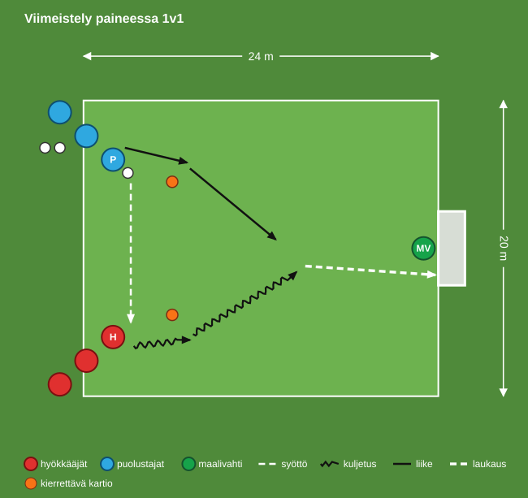

# Viimeistely paineessa 1v1

## Tavoite
Hyökkääjä oppii ottamaan syötön haltuun suuntaan, etenemään nopeasti kohti
maalia ja viimeistelemään ennen kuin puolustaja ehtii väliin. Puolustaja oppii
kirimään pallollisen tasalle, tulemaan oikeassa kulmassa ja estämään laukauksen
tai ohjaamaan hyökkääjän pois maalin edestä.

## Järjestelyt
- Alue 24 × 20 m (pituus maaliin 24 m, leveys 20 m).
- Iso maali ja maalivahti alueen toisessa päässä.
- Lähtöpäädyssä kaksi jonoa 12 metrin päässä toisistaan: puolustajat vasemmalla
  ja hyökkääjät oikealla. Kummankin jonon eteen, noin 4 metrin päähän, asetetaan
  kartio, joka on kierrettävä ulkokautta.
- Puolustajilla on pallot.
- 6–8 kenttäpelaajaa ja maalivahti. Isommalle ryhmälle tehdään toinen
  suorituspaikka viereen.
- Välineet: iso maali, 2 kartiota, palloja.

## Kulku
1. Jonon ensimmäinen puolustaja syöttää pallon poikittain hyökkääjälle ja lähtee
   heti syötön jälkeen kiertämään omaa kartiotaan.
2. Hyökkääjä ottaa syötön vastaan, kuljettaa oman kartionsa ulkokautta ja
   hyökkää kohti maalia.
3. Puolustaja kiertää kartionsa ja yrittää ehtiä hyökkääjän ja maalin väliin,
   estää laukauksen ja voittaa pallon.
4. Hyökkääjä yrittää tehdä maalin maalivahdin ohi.
5. Jos puolustaja voittaa pallon, hän yrittää kuljettaa sen lähtöpäädyn rajan
   yli (siirtymä). Hyökkääjä yrittää heti voittaa pallon takaisin.
6. Tilanne päättyy maaliin, maalivahdin torjuntaan, puolustajan kuljetukseen
   rajan yli tai pallon menemiseen ulos. Pelaajat palaavat omiin jonoihinsa.
7. Hyökkääjät ja puolustajat vaihtavat rooleja intervalleittain.

## Valmennuspisteet
Valitaan 1–2 kerrallaan.
- **1H:** ensimmäinen kosketus eteen kartion ohi, jotta eteneminen alkaa jo vastaanotosta.
- **1H:** kuljeta suoraan kohti maalia ja pidä pallo puolustajasta kauemmalla jalalla.
- **1H:** laukaise heti, kun laukaisupaikka aukeaa, ennen kuin puolustaja ehtii väliin.
- **1H:** jos puolustaja ehtii eteen, vartalo pallon ja puolustajan väliin ja suunnanmuutos.
- **1H:** pallon menetyksen jälkeen heti puolustamaan, ettei puolustaja pääse kuljettamaan rajan yli.
- **1P:** lähtö heti syötön jälkeen ja tiukka kierto kartion ympäri.
- **1P:** kiri kohti hyökkääjän ja maalin välistä linjaa, ei suoraan palloon.
- **1P:** jarrutus ja matala asento ennen kaksinkamppailua.
- **1P:** ohjaa hyökkääjä kohti pallon puoleista sivurajaa, pois maalin edestä, ja blokkaa laukaus.

## Onnistumisen mittari
Hyökkääjät pääsevät laukaisemaan yhä useammin ennen kuin puolustaja ehtii
väliin. Puolustajat ehtivät hyökkääjän ja maalin väliin, estävät laukauksia ja
ohjaavat hyökkääjiä sivulle.
