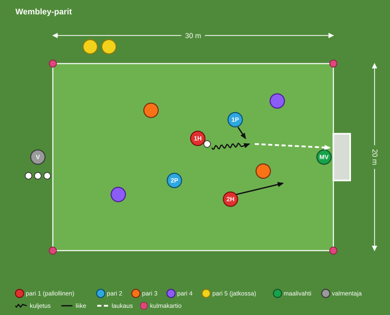

# Wembley-parit

## Tavoite
Hyökkääjä oppii viimeistelemään nopeasti ahtaassa tilassa, jossa painetta tulee
joka suunnasta, ja suojaamaan palloa, kunnes laukaisupaikka aukeaa. Pari oppii
tarjoamaan pallolliselle tukea ja hyödyntämään toisen pallon. Pallon menettänyt
pari oppii puolustamaan heti ja estämään laukauksen.

## Järjestelyt
- Alue 30 × 20 m (pituus maaliin 30 m, leveys 20 m), kulmakartiot.
- Iso maali ja maalivahti alueen toisessa päässä.
- 8–12 kenttäpelaajaa pareittain, jokaisella parilla oma liivin väri, sekä maalivahti.
- Valmentaja ja pallovarasto maalia vastapäätä olevalla päätyrajalla.
- Välineet: iso maali, 4 kartiota, liivit, palloja.

## Kulku
1. Kaikki parit ovat alueella yhtä aikaa. Valmentaja syöttää pallon alueelle,
   ja kaikki parit pelaavat sitä toisiaan vastaan.
2. Pallollinen pari hyökkää kohti maalia, ja kaikki muut parit puolustavat.
   Kun pallo vaihtaa omistajaa, uusi pallollinen pari hyökkää heti.
3. Kun pari tekee maalin, se pääsee jatkoon ja siirtyy alueen sivulle
   odottamaan. Valmentaja syöttää heti uuden pallon, ja peli jatkuu
   jäljellä olevien parien kesken.
4. Kun pallo menee ulos tai maalivahti saa sen haltuun, valmentaja syöttää
   uuden pallon.
5. Kierros päättyy, kun alueella on jäljellä yksi pari ilman maalia. Se putoaa
   pois, ja seuraava kierros pelataan jatkoon päässeillä pareilla.
6. Kierroksia pelataan, kunnes jäljellä on voittajapari. Pudonneet parit
   tekevät sivussa lyhyen pallotehtävän, kunnes uusi peli alkaa kaikilla pareilla.

## Valmennuspisteet
Valitaan 1–2 kerrallaan.
- **1H:** laukaise heti, kun laukaisupaikka aukeaa – ruuhkassa ei ehdi
  ottaa ylimääräisiä kosketuksia.
- **1H:** kun laukaisupaikkaa ei ole, vartalo pallon ja lähimmän puolustajan
  väliin ja pallo kauemmalla jalalla.
- **2H:** tarjoudu pallolliselle vapaaseen tilaan, ei samaan ruuhkaan.
- **2H:** seuraa laukausta maalia kohti toisen pallon varalle.
- **1P:** pallon menetyksen jälkeen heti painostamaan ja estämään laukaus.
- **2P:** peitä pallollisen syöttölinja pariinsa ja ole valmis voittamaan toinen pallo.

## Onnistumisen mittari
Laukaukset lähtevät vähillä kosketuksilla, parit tekevät maaleja myös
yhteistyöllä ja toisista palloista, ja pallon menettänyt pari painostaa heti.
